# Implicit State Machines

**Date:** 2026-11-07

**Scope:** Desktop application (`src/desktop`, `src/platform`) and the bundled `ShareX.ImageEditor` submodule. The Android and iOS clients were not audited.

**Status:** Analysis only. No behavior was changed.

## 1. What This Document Counts

An **implicit state machine** is a lifecycle or mode whose states are represented by an enum, one or more booleans, nullable fields, ref-counts, or even free-form strings, and whose transitions are ordinary method calls spread across one or more classes. There is no single transition table, no single owner of the state, and usually no guard that rejects an illegal transition.

This document covers:

- the state carriers and the class that owns them,
- the transitions that are actually implemented,
- where the transitions are written, and
- the parts that do not fit the happy path: missing terminal states, duplicated state, races, and cleanup paths that bypass the machine.

Line numbers are from 2026-11-07 and will drift.

The only explicitly named state machine in the desktop app is
[`SelectionStateMachine`](../../src/desktop/app/XerahS.RegionCapture/Services/SelectionStateMachine.cs).
It is included because its transition method has no validation, so it is explicit in name only.

## 2. Inventory

### 2.1 Substantial lifecycle machines

| # | Machine | State carrier | Primary location |
|---|---|---|---|
| 1 | Worker task lifecycle | `TaskStatus` plus lifetime booleans | [`WorkerTask.cs`](../../src/desktop/core/XerahS.Core/Tasks/WorkerTask.cs) |
| 2 | Task admission and upload slots | `UploadQueue._running`, `_waiting`, `TaskInfo.UploadQueueEntry/Place` | [`UploadQueue.cs`](../../src/desktop/core/XerahS.Core/Managers/UploadQueue.cs), [`TaskStart.cs`](../../src/desktop/core/XerahS.Core/Tasks/TaskStart.cs) |
| 3 | Upload confirmation gates | `BeforeUploadConfirmed`, `LargeFileConfirmed`, `UploadCancelled`, `UploadAttemptedDuringCapture` | [`UploadJobProcessor.cs`](../../src/desktop/core/XerahS.Core/Tasks/Processors/UploadJobProcessor.cs) |
| 4 | Screen recording session and take | `RecordingStatus` plus session flags | [`ScreenRecordingManager.cs`](../../src/desktop/core/XerahS.Core/Managers/ScreenRecordingManager.cs) |
| 5 | Recording backends | `RecordingStatus`, `_stopRequested`, portal session flags | `FFmpegRecordingService.cs`, `ScreenRecorderService.cs`, `WaylandPortalRecordingService.cs` |
| 6 | Region selection interaction | `CaptureState`, `InteractionKind`, `_resizeHandle` | [`SelectionStateMachine.cs`](../../src/desktop/app/XerahS.RegionCapture/Services/SelectionStateMachine.cs) |
| 7 | Per-monitor overlay ownership | `OverlayMonitorState` | [`OverlayWindow.ActiveMonitor.cs`](../../src/desktop/app/XerahS.RegionCapture/UI/OverlayWindow.ActiveMonitor.cs) |
| 8 | Capture session lifetime | `TaskCompletionSource`, overlay list, `_disposed` | [`OverlayManager.cs`](../../src/desktop/app/XerahS.RegionCapture/Services/OverlayManager.cs) |
| 9 | Auto capture | `IsRunning`, two fullscreen flags, timers | [`AutoCaptureViewModel.cs`](../../src/desktop/app/XerahS.UI/ViewModels/AutoCaptureViewModel.cs) |
| 10 | Scrolling capture | `_busy`, `_closed`, `_isCapturing`, `_captureCts`, result status | [`ScrollingCaptureViewModel.cs`](../../src/desktop/app/XerahS.UI/ViewModels/ScrollingCaptureViewModel.cs) |
| 11 | Persistent upload queue | `_queue`, `_isProcessing`, retry loop | [`UploadQueueService.cs`](../../src/desktop/core/XerahS.Core/Services/UploadQueueService.cs) |
| 12 | OCR indexing | in-memory queue plus persisted status strings | [`OcrIndexingService.cs`](../../src/desktop/core/XerahS.Core/Services/OcrIndexingService.cs), [`HistoryOcrIndexStore.cs`](../../src/desktop/core/XerahS.History/HistoryOcrIndexStore.cs) |
| 13 | Update check, download, install | `UpdateStatus`, `DownloaderFormStatus`, `IsUpdateDialogOpen` | [`UpdateChecker.cs`](../../src/desktop/core/XerahS.Common/UpdateChecker/UpdateChecker.cs), [`DownloaderWindowViewModel.cs`](../../src/desktop/app/XerahS.UI/ViewModels/DownloaderWindowViewModel.cs), [`UpdateService.cs`](../../src/desktop/app/XerahS.UI/Services/UpdateService.cs) |
| 14 | Toast lifetime | `_isDurationEnd`, `_isMouseInside`, `_isMenuOpen`, `_isFileDragActive`, `_isDragging` | [`ToastViewModel.cs`](../../src/desktop/app/XerahS.UI/ViewModels/ToastViewModel.cs), [`ToastWindow.axaml.cs`](../../src/desktop/app/XerahS.UI/Views/ToastWindow.axaml.cs) |
| 15 | Mouse highlighter sharing | `_manualActive`, `_recordingRequests`, `_nativeUsers`, `_shutdown` | [`MouseHighlighterManager.cs`](../../src/desktop/app/XerahS.UI/Services/MouseHighlighterManager.cs) |

### 2.2 Shell and UI machines

| Machine | State carrier | Primary location |
|---|---|---|
| Assistant conversation | `IsBusy`, `HasPendingConfirmation`, `_pendingAction`, `_requestCts` | [`AssistantViewModel.cs`](../../src/desktop/app/XerahS.UI/ViewModels/AssistantViewModel.cs) |
| After-capture goal | `AfterCaptureGoal` plus booleans over task flags | [`AfterCaptureViewModel.cs`](../../src/desktop/app/XerahS.UI/ViewModels/AfterCaptureViewModel.cs) |
| Upload content queue | `UploadQueueItemStatus`, `IsPending`, `IsFailed`, `IsUploading` | [`UploadContentViewModel.cs`](../../src/desktop/app/XerahS.UI/ViewModels/UploadContentViewModel.cs) |
| Hotkey registration | `HotkeyStatus`, `_hotkeyMap`, `HotkeysDisabled`, `IgnoreHotkeys` | [`WorkflowManager.cs`](../../src/desktop/core/XerahS.Core/Hotkeys/WorkflowManager.cs) |
| Hotkey backend | `HotkeyBackendState`, session fields, fallback service | [`WaylandPortalHotkeyService.cs`](../../src/platform/XerahS.Platform.Linux/Services/WaylandPortalHotkeyService.cs) |
| App and window lifecycle | `App.IsExiting`, `App.StartedInTray`, `_silentRunHideApplied`, `_onboardingShown` | [`App.axaml.cs`](../../src/desktop/app/XerahS.UI/App.axaml.cs), [`MainWindow.axaml.cs`](../../src/desktop/app/XerahS.UI/Views/MainWindow.axaml.cs) |
| Watch folders | `_acceptNewFiles`, `_activeProcessingCount`, `_inFlight`, `_isDisposed` | [`WatchFolderManager.cs`](../../src/desktop/core/XerahS.Core/Managers/WatchFolderManager.cs) |
| Cloud OAuth and session | pending, consumed, and waiter dictionaries; session store | [`XerahSCloudOAuth.cs`](../../src/desktop/core/XerahS.Core/Cloud/XerahSCloudOAuth.cs), [`XerahSCloudApiClient.cs`](../../src/desktop/core/XerahS.Core/Cloud/XerahSCloudApiClient.cs) |
| Cloud publish and delete | history tag fields (`Published`, `PublishedId`, `PublishedOwnerId`) | [`HistoryPublishMetadata.cs`](../../src/desktop/core/XerahS.History/HistoryPublishMetadata.cs), [`HistoryViewModel.cs`](../../src/desktop/app/XerahS.UI/ViewModels/HistoryViewModel.cs) |
| Onboarding wizard | step index, `SkippedSteps`, `LastCompletedStepIndex` | [`OnboardingWizardViewModel.cs`](../../src/desktop/app/XerahS.UI/Onboarding/OnboardingWizardViewModel.cs) |
| Plugin installer | `_hasLoadedCommunityPlugins`, `IsLoadingCommunityPlugins`, `IsInstalling` | [`PluginInstallerViewModel.cs`](../../src/desktop/app/XerahS.UI/ViewModels/PluginInstallerViewModel.cs) |
| Network monitor | `IsMonitoring`, `IsConnected`, `HasConnectionState`, `_isFirstEvent`, `_failCount` | [`InternetConnectionMonitor.cs`](../../src/desktop/core/XerahS.Common/NetworkMonitor/InternetConnectionMonitor.cs) |
| Single instance | `IsFirstInstance`, lock results, `RedirectError` | [`SingleInstanceManager.cs`](../../src/desktop/core/XerahS.Common/SingleInstanceManager.cs) |

### 2.3 Bundled editor

| Machine | State carrier | Primary location |
|---|---|---|
| Editor pointer interaction | `_isDrawing`, `_isCreatingEffect`, `_isMovingShapeDuringCreation`, `_cropActive`, `_isDraggingCropHandle` | [`EditorInputController.cs`](../../ShareX.ImageEditor/src/ShareX.ImageEditor/Presentation/Controllers/EditorInputController.cs) |
| Editor document session | `IsDirty`, `IsModalOpen`, `TaskResult`, start-screen flag | [`MainViewModel.cs`](../../ShareX.ImageEditor/src/ShareX.ImageEditor/Presentation/ViewModels/MainViewModel.cs) |

### 2.4 Small or vestigial

These are still stateful, but they are narrow enough that a diagram adds little value.

| Machine | State carrier | Location | Note |
|---|---|---|---|
| Tray single/double click | `_trayClickCount` plus timer | [`TrayIconController.cs`](../../src/desktop/app/XerahS.UI/Services/TrayIconController.cs) | Single click is deferred until the double-click window expires. |
| Pin window mode | `_isMinimized`, `_preMinimizeScale`, opacity, scale | [`PinnedImageViewModel.cs`](../../src/desktop/app/XerahS.UI/ViewModels/PinnedImageViewModel.cs) | Normal and minimized are the only modes. |
| File download | `IsDownloading`, `IsCanceled` | [`FileDownloader.cs`](../../src/desktop/core/XerahS.Common/FileDownloader.cs) | `IsCanceled` is also set on some exception paths, so it is not strictly “user cancelled”. |
| Pin-to-screen startup | dialog result plus target choice | [`PinToScreenToolService.cs`](../../src/desktop/app/XerahS.UI/Services/PinToScreenToolService.cs) | Screen, clipboard, file, and cancel outcomes. |
| Settings search index | `_applicationIndexed`, `_destinationIndexed`, `_snapshot` | [`SettingsSearchService.cs`](../../src/desktop/app/XerahS.UI/Services/SettingsSearch/SettingsSearchService.cs) | Catalog-only, application-indexed, destination-indexed, fully indexed. |
| Color picker screen pick | `IsScreenPicking` | [`ColorPickerViewModel.cs`](../../src/desktop/app/XerahS.UI/ViewModels/ColorPickerViewModel.cs) | Disables the pick command while the screen overlay runs. |
| Plugin manifest preview | `Manifest`, `ErrorMessage`, `StatusMessage` | [`PluginInstallerViewModel.cs`](../../src/desktop/app/XerahS.UI/ViewModels/PluginInstallerViewModel.cs) | Package selected versus preview valid. |
| `WorkflowTask` | `IsCompleted`, `Result` | [`WorkflowTask.cs`](../../src/desktop/core/XerahS.Core/Tasks/WorkflowTask.cs) | No code constructs this class in the repository. |
| Legacy recording enums | `ScreenRecordState`, `ScreenRecordingStatus` | `XerahS.RegionCapture/Enums.cs`, `XerahS.Core/TaskSettingsEnums.cs` | Duplicated and unused by the live recording path. |
| Legacy hotkey state | `Common.HotkeyStatus`, `CommonHotkeyInfo` | [`CommonHotkeyInfo.cs`](../../src/desktop/core/XerahS.Common/Input/CommonHotkeyInfo.cs) | Not used outside its own file. |

## 3. Core Pipeline Machines

### 3.1 Worker task lifecycle

**Carrier:** `TaskStatus` (InQueue, Preparing, Working, Stopping, Stopped, Failed, Completed, History, Canceled) plus `_recordingInProgress`, `_hasFinished`, `_disposeRequested`, `_disposed`, `_hasImageOutput`, and `_failureNotificationShown`.

**Owner:** `WorkerTask`, but status is also written by `WorkerTaskCapture`, `WorkerTaskRecording`, `CaptureStage`, `FinalizationStage`, and processors.

**Declared states:** [`Enums.cs:120-131`](../../src/desktop/core/XerahS.Core/Enums.cs)

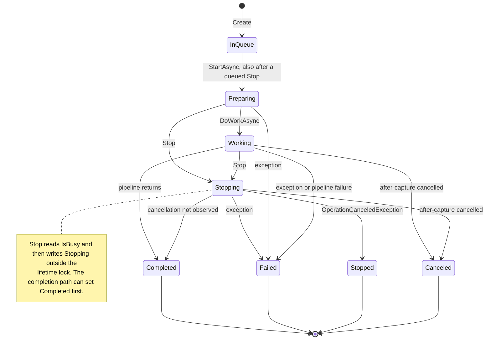

**How the state is actually written:**

- `StartAsync` guards on `Status == InQueue`, sets `Preparing`, then `DoWorkAsync` sets `Working` ([`WorkerTask.cs:172-190`](../../src/desktop/core/XerahS.Core/Tasks/WorkerTask.cs), [`275-281`](../../src/desktop/core/XerahS.Core/Tasks/WorkerTask.cs)).
- `Stop()` sets `Stopping` only when `IsWorking`; a queued task keeps `InQueue`, has its token cancelled, and still enters `StartAsync` later ([`WorkerTask.cs:325-342`](../../src/desktop/core/XerahS.Core/Tasks/WorkerTask.cs)).
- The `finally` block converts anything that is not `Failed`, `Stopped`, or `Canceled` into `Completed`, then fires completion events ([`WorkerTask.cs:234-248`](../../src/desktop/core/XerahS.Core/Tasks/WorkerTask.cs)).
- The pipeline can set `Canceled` or `Failed` through `PipelineContext.Status`; `ResolvePipelineStatus` only preserves `Stopped` from the worker ([`FinalizationStage.cs:60-90`](../../src/desktop/core/XerahS.Core/Tasks/Pipeline/FinalizationStage.cs), [`WorkerTask.cs:299-301`](../../src/desktop/core/XerahS.Core/Tasks/WorkerTask.cs)).
- A failed recording sets `Status = Stopped` directly ([`WorkerTaskRecording.cs:194`](../../src/desktop/core/XerahS.Core/Tasks/WorkerTaskRecording.cs)).

**Observations:**

1. `TaskStatus.History` is never assigned anywhere in the repository. It is a declared state with no transition.
2. `Stop()` can leave a finished task in `Stopping`: the check and the write are not one atomic transition, and the completion path runs concurrently in the `finally` block. The task is finished (`HasFinished` true) but its last visible status can be `Stopping`.
3. A queued task that is stopped still transitions `InQueue → Preparing → Working` before cancellation is observed. The final state is correct, but the intermediate sequence is not what “stop a queued task” suggests.
4. `IsSuccessful` excludes only `Failed`, `Stopped`, and `Canceled`; it does not require `Completed`. A task with an artifact can therefore be “successful” before it has finished.
5. Disposal is itself a small machine: `_disposeRequested`, `_hasFinished`, and `_disposed` defer `Dispose` until the pipeline and completion handlers release the image ([`WorkerTask.cs:483-500`](../../src/desktop/core/XerahS.Core/Tasks/WorkerTask.cs)).

### 3.2 Task admission and upload slots

**Carrier:** `UploadQueue._running`, `_waiting`, and per-task `TaskInfo.UploadQueueEntry` and `UploadQueuePlace`.

**Owner:** `UploadQueue` owns the slot count; `TaskStart` owns the hand-off from reservation to holding.

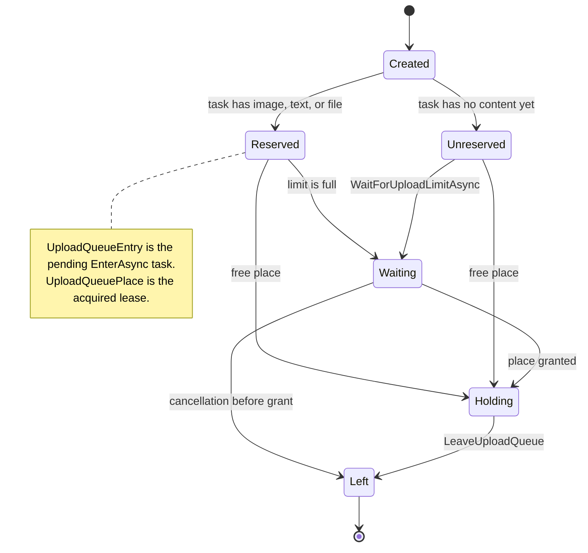

**How it works:**

- Tasks that start with content reserve a place at creation (`TaskManager` calls `ReserveUploadQueuePlace`) and wait for it when they reach finalization ([`TaskStart.cs:44-69`](../../src/desktop/core/XerahS.Core/Tasks/TaskStart.cs)).
- `UploadQueue.EnterAsync` either increments `_running` immediately or appends a `TaskCompletionSource` to `_waiting`; `Release` decrements and starts waiters in order ([`UploadQueue.cs:62-124`](../../src/desktop/core/XerahS.Core/Managers/UploadQueue.cs)).
- The `Place` lease is idempotent through `Interlocked.Exchange` ([`UploadQueue.cs:127-134`](../../src/desktop/core/XerahS.Core/Managers/UploadQueue.cs)).
- `FinalizationStage` releases the place in its `finally` ([`FinalizationStage.cs:44-51`](../../src/desktop/core/XerahS.Core/Tasks/Pipeline/FinalizationStage.cs)).

**Observations:**

- The state is split across two objects. `TaskInfo` can hold a pending entry, an acquired place, or neither, and no type enforces that only one is set.
- `LeaveUploadQueue` handles a task that ends before it needs its reserved place by attaching a continuation that disposes the place once granted ([`TaskStart.cs:57-69`](../../src/desktop/core/XerahS.Core/Tasks/TaskStart.cs)).
- A cancellation that lands after a waiter has been granted a place but before the caller resumes can return a live lease to a caller that is about to throw. The normal pipeline `finally` releases it, but code that calls `EnterAsync` directly does not have that safety net.

### 3.3 Upload confirmation gates

**Carrier:** four one-shot booleans on `TaskInfo`:

- `BeforeUploadConfirmed`
- `LargeFileConfirmed`
- `UploadCancelled`
- `UploadAttemptedDuringCapture`

**Owner:** `UploadJobProcessor`, with the final decision made again in `FinalizationStage`.

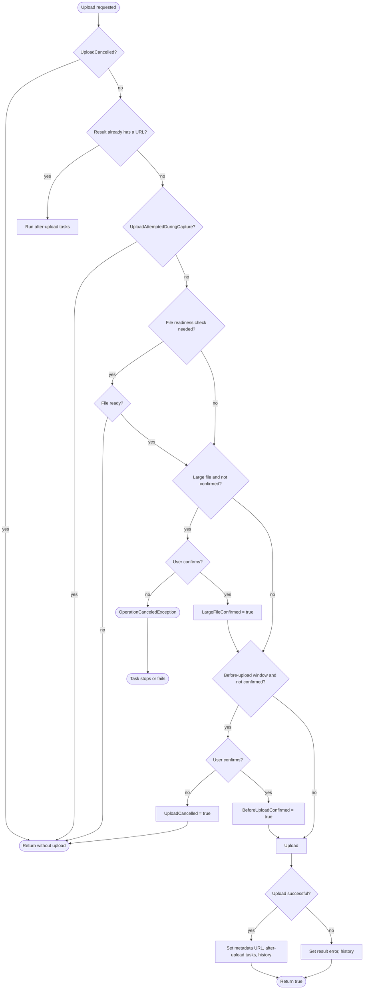

**Observations:**

- `UploadAttemptedDuringCapture` is set before the capture-time upload runs. If that upload is cancelled or fails, the finalization stage deliberately does not upload again; the failure is reported once ([`UploadJobProcessor.cs:90-106`](../../src/desktop/core/XerahS.Core/Tasks/Processors/UploadJobProcessor.cs)).
- `UploadCancelled` is checked at several points and returns `true` rather than throwing, so it is a “successful no-op” state rather than a failure state.
- The gates are per-task latches. Retrying the same task in-process (not a normal path) would see the old values and skip the dialogs.
- `FinalizationStage` repeats the success check and converts a failed upload into `TaskStatus.Failed` unless `UploadCancelled` is set ([`FinalizationStage.cs:69-90`](../../src/desktop/core/XerahS.Core/Tasks/Pipeline/FinalizationStage.cs)).

### 3.4 Screen recording session and take

**Carrier:** `RecordingStatus` plus seven session flags:

- `_sessionActive`
- `_isPaused`
- `_isFinalized`
- `_discardRequested`
- `_restartRequested`
- `_finishing`
- `_preparedRecording`

**Owner:** `ScreenRecordingManager`, with a take loop in `WorkerTask.RecordUntilStoppedAsync`.

**Declared status:** [`RecordingEnums.cs:48-70`](../../src/desktop/app/XerahS.RegionCapture/ScreenRecording/RecordingEnums.cs)

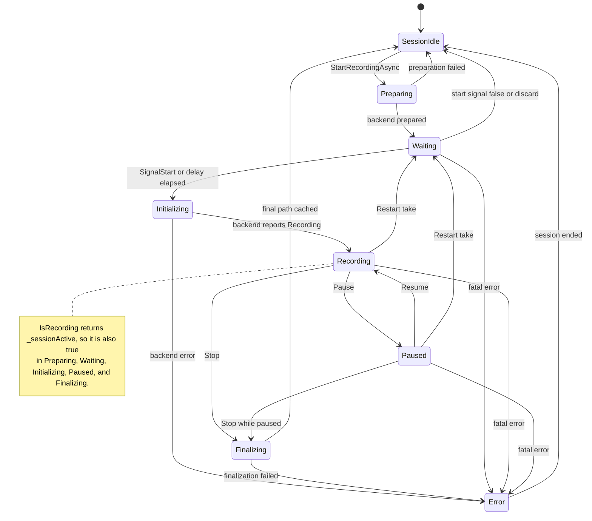

The take loop is a second, smaller machine:

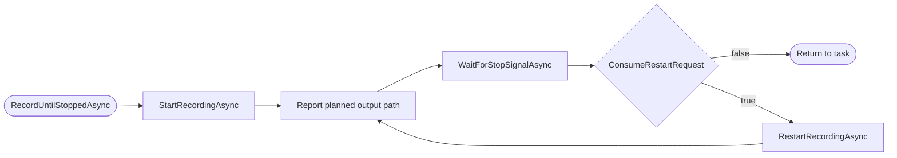

**How it works:**

- `StartRecordingAsync` sets `_sessionActive = true` and clears `_discardRequested`, `_isFinalized`, and `_cachedFinalPath` under `_lock` before acquiring `_stopSemaphore` ([`ScreenRecordingManager.cs:285-296`](../../src/desktop/core/XerahS.Core/Managers/ScreenRecordingManager.cs)).
- `RunTakeAsync` publishes `Waiting`, waits for the auto-start delay or the manual start signal, starts the backend, then publishes duration updates from a timer ([`ScreenRecordingManager.cs:373-436`](../../src/desktop/core/XerahS.Core/Managers/ScreenRecordingManager.cs)).
- `StopRecordingAsync` finalizes segments, emits `Idle`, then sets `_sessionActive = false` and `_isFinalized = true` ([`ScreenRecordingManager.cs:461-551`](../../src/desktop/core/XerahS.Core/Managers/ScreenRecordingManager.cs)).
- `DiscardRecordingAsync` cancels initialization or finalizes without output, sets `_discardRequested`, and ends in `Idle` ([`ScreenRecordingManager.cs:560-596`](../../src/desktop/core/XerahS.Core/Managers/ScreenRecordingManager.cs)).
- The backend's `Idle` notification is suppressed from waking the waiting task while `_finishing` is set ([`ScreenRecordingManager.cs:880-905`](../../src/desktop/core/XerahS.Core/Managers/ScreenRecordingManager.cs)).

**Observations:**

1. **`IsRecording` does not mean “frames are being recorded.”** It means “a session is active” and is true during Waiting, Initializing, Paused, and Finalizing. The UI has a separate `IsRecording` flag derived from `RecordingStatus.Recording`, so two different meanings exist under the same name.
2. **Start-after-stop overlap.** `StartRecordingAsync` mutates `_sessionActive` and `_isFinalized` *before* waiting for `_stopSemaphore`. A new start can run while the previous `StopRecordingAsync` is still finalizing and has not set `_isFinalized = true` yet. The old stop can then set `_isFinalized = true` and `_cachedFinalPath` after the new session has begun. `RunTakeAsync` checks `_isFinalized` after starting the backend and can return immediately while the new backend is recording ([`ScreenRecordingManager.cs:285-296`](../../src/desktop/core/XerahS.Core/Managers/ScreenRecordingManager.cs), [`522-529`](../../src/desktop/core/XerahS.Core/Managers/ScreenRecordingManager.cs), [`396-401`](../../src/desktop/core/XerahS.Core/Managers/ScreenRecordingManager.cs)).
3. **Restart and discard are not part of `RecordingStatus`.** They are booleans consumed by `WorkerTask.RecordUntilStoppedAsync`; a restart appears to the manager as a discard followed by a new take ([`WorkerTaskRecording.cs:44-70`](../../src/desktop/core/XerahS.Core/Tasks/WorkerTaskRecording.cs)).
4. **The status is copied four times.** `ScreenRecordingManager` emits it; `RecordingViewModel`, `TrayIconHelper`, and `RecordingControlWindow` each keep their own `RecordingStatus` field ([`RecordingViewModel.cs:61`](../../src/desktop/app/XerahS.UI/ViewModels/RecordingViewModel.cs), [`TrayIconHelper.cs:94`](../../src/desktop/app/XerahS.UI/TrayIconHelper.cs), [`RecordingControlWindow.cs:62`](../../src/desktop/app/XerahS.UI/Views/RecordingControlWindow.cs)). A missed event leaves one copy behind.

### 3.5 Recording backends

**Carrier:** `RecordingStatus` and `_stopRequested` in each backend. The Wayland portal backend adds `_paused`, `_preserveSession`, `_sessionHandle`, and `_sessionProxy`.

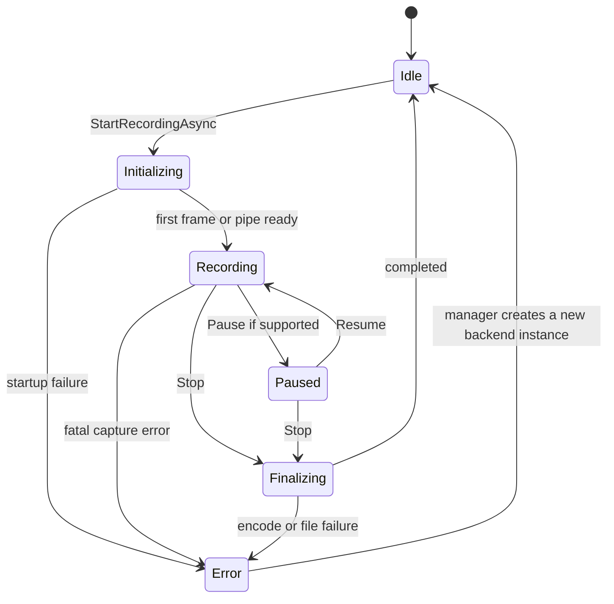

**Where each backend implements it:**

- FFmpeg fallback: [`FFmpegRecordingService.cs:41-47`](../../src/desktop/app/XerahS.RegionCapture/ScreenRecording/FFmpegRecordingService.cs), [`80-190`](../../src/desktop/app/XerahS.RegionCapture/ScreenRecording/FFmpegRecordingService.cs).
- Native screen recorder: [`ScreenRecorderService.cs:48-52`](../../src/desktop/app/XerahS.RegionCapture/ScreenRecording/ScreenRecorderService.cs), [`117-265`](../../src/desktop/app/XerahS.RegionCapture/ScreenRecording/ScreenRecorderService.cs).
- Wayland portal: [`WaylandPortalRecordingService.cs:56-65`](../../src/platform/XerahS.Platform.Linux/Recording/WaylandPortalRecordingService.cs), [`888-1020`](../../src/platform/XerahS.Platform.Linux/Recording/WaylandPortalRecordingService.cs).

**Observations:**

- Each backend has its own `UpdateStatus`, `HandleFatalError`, and stop path. The same status value can mean subtly different things in each.
- The Wayland portal uses `_preserveSession` to keep the portal session across a restart and `_paused` to split segments. That is a real extra state that `RecordingStatus` does not represent.
- `_stopRequested` is a separate latch that suppresses `Idle` and error transitions while stopping. It can disagree with `_status` during shutdown.

### 3.6 Region selection interaction

**Carrier:** `CaptureState` plus `InteractionKind` (None, Creating, Moving, Resizing), `_resizeHandle`, `_modifiers`, and `_isMovingSelectionDuringCreation`.

**Owner:** `SelectionStateMachine`.

**Declared states:** [`CaptureState.cs:30-56`](../../src/desktop/app/XerahS.RegionCapture/Models/CaptureState.cs)

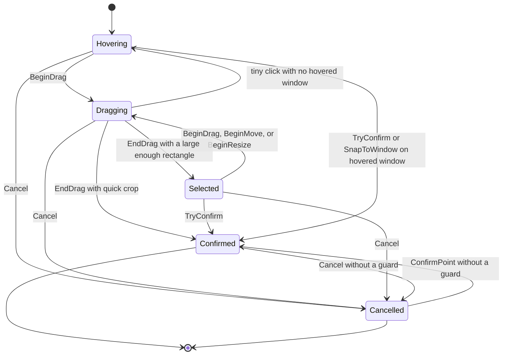

**How it works:**

- `BeginDrag`, `BeginMove`, and `BeginResize` transition to `Dragging` and set `InteractionKind` ([`SelectionStateMachine.cs:166-207`](../../src/desktop/app/XerahS.RegionCapture/Services/SelectionStateMachine.cs)).
- `EndDrag` either finishes to `Selected`, snaps to a hovered window, returns to `Hovering`, or confirms immediately when quick crop is enabled ([`SelectionStateMachine.cs:226-267`](../../src/desktop/app/XerahS.RegionCapture/Services/SelectionStateMachine.cs)).
- `TryConfirm` and `SnapToWindow` confirm from `Selected` or from a hovered window in `Hovering` ([`SelectionStateMachine.cs:271-301`](../../src/desktop/app/XerahS.RegionCapture/Services/SelectionStateMachine.cs)).
- `TransitionTo` only suppresses same-state transitions; it does not validate legal transitions ([`SelectionStateMachine.cs:553-560`](../../src/desktop/app/XerahS.RegionCapture/Services/SelectionStateMachine.cs)).

**Observations:**

1. **The named state machine has no transition table.** `TransitionTo` accepts any target; the guards are individually written in each caller.
2. **`Cancel()` is unguarded.** It can move `Confirmed → Cancelled` and fire `SelectionCancelled` after `SelectionConfirmed`.
3. **`ConfirmPoint()` is unguarded.** It can confirm from `Cancelled` or from a state where no selection exists.
4. **`InteractionKind` is a second, hidden state machine** inside `Dragging`. Moving or resizing calls `BeginMove`/`BeginResize`, which transition to `Dragging` again; the state is already `Dragging`, so the transition is a no-op while the interaction kind changes.
5. The overlay's completion is a `TaskCompletionSource` with `TrySetResult`, so a double event usually completes once, but the UI handlers and any direct subscribers still see both events.

### 3.7 Per-monitor overlay ownership

**Carrier:** `OverlayMonitorState` (Active, Pending, Inactive) on each `OverlayWindow`.

**Owner:** `ActiveMonitorCoordinator` for the session, `OverlayWindow` for the local flag.

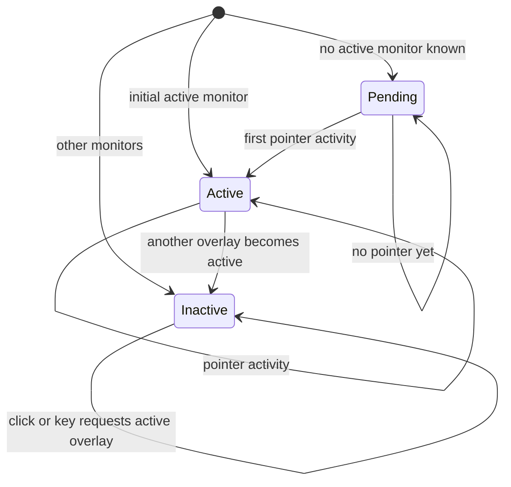

**How it works:**

- If the cursor's monitor is known, it starts `Active` and all others start `Inactive`; otherwise every overlay starts `Pending` ([`ActiveMonitorCoordinator.cs:58-86`](../../src/desktop/app/XerahS.RegionCapture/Services/ActiveMonitorCoordinator.cs)).
- The first pointer event on a `Pending` overlay promotes it to `Active` and demotes the others ([`ActiveMonitorCoordinator.cs:88-97`](../../src/desktop/app/XerahS.RegionCapture/Services/ActiveMonitorCoordinator.cs)).
- Clicking an inactive overlay does not promote it; it refocuses the current active overlay ([`ActiveMonitorCoordinator.cs:99-102`](../../src/desktop/app/XerahS.RegionCapture/Services/ActiveMonitorCoordinator.cs)).
- `SetMonitorState` updates the local flag and cursor confinement but does not validate the old state ([`OverlayWindow.ActiveMonitor.cs:109-166`](../../src/desktop/app/XerahS.RegionCapture/UI/OverlayWindow.ActiveMonitor.cs)).

**Observations:**

- `Inactive → Active` has no transition except initial construction. That is intentional for active-monitor mode, but it means an inactive overlay can never become active after the initial choice.
- `Pending` is promoted only by pointer input. Keyboard-only interaction with a pending overlay is not modeled.
- `ActiveMonitorCoordinator.ActiveOverlay` is a second copy of the active state; it is set in `SetActive` and never updated if an overlay changes state directly.

### 3.8 Capture session lifetime

**Carrier:** `TaskCompletionSource<RegionSelectionResult?>`, `_overlays`, `_activeMonitorCoordinator`, `_disconnectPointerPresence`, `_disposed`.

**Owner:** `OverlayManager`; one manager is created per capture.

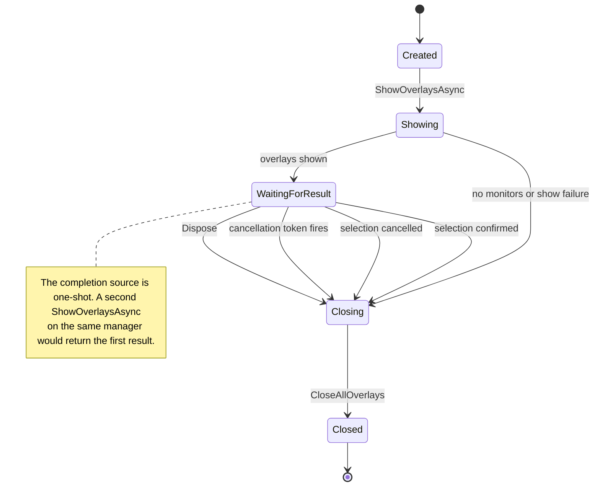

**How it works:**

- `ShowOverlaysAsync` creates one overlay per monitor, hooks pointer presence, shows the primary overlay first, then awaits `_completionSource.Task` ([`OverlayManager.cs:77-190`](../../src/desktop/app/XerahS.RegionCapture/Services/OverlayManager.cs)).
- Cancellation is posted to the UI thread and calls `TrySetCanceled` ([`OverlayManager.cs:85-86`](../../src/desktop/app/XerahS.RegionCapture/Services/OverlayManager.cs)).
- `CloseAllOverlays` runs in `finally`, disposes the active-monitor coordinator, disconnects pointer presence, and closes every overlay ([`OverlayManager.cs:266-289`](../../src/desktop/app/XerahS.RegionCapture/Services/OverlayManager.cs)).
- `Dispose` sets `_disposed`, closes overlays, and cancels the completion source ([`OverlayManager.cs:291-298`](../../src/desktop/app/XerahS.RegionCapture/Services/OverlayManager.cs)).

**Observations:**

- The manager is effectively single-use but does not reject a second `ShowOverlaysAsync` when `_completionSource` is already completed.
- `Dispose` can cancel the task while `ShowOverlaysAsync` is still showing overlays; the `finally` then closes them.
- `ShowOverlayDetached` has a retry path that briefly shows the main window if the owner is not visible ([`OverlayManager.cs:227-263`](../../src/desktop/app/XerahS.RegionCapture/Services/OverlayManager.cs)). That is a second, hidden UI state outside the capture state.

### 3.9 Auto capture

**Carrier:** `IsRunning`, `_isFullScreen`, `_isFullScreenCapture`, `_captureTimer`, `_statusTimer`, `_stopwatch`, `_delayMs`.

**Owner:** `AutoCaptureViewModel`.

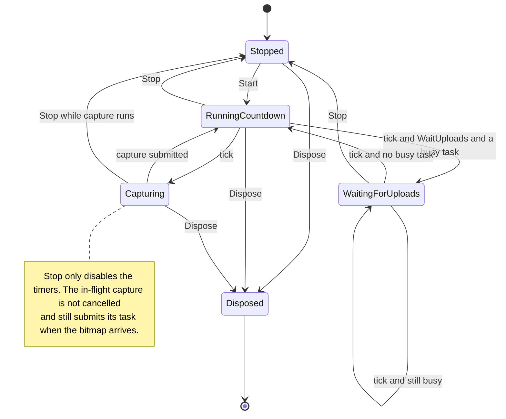

**How it works:**

- `StartCapture` sets `IsRunning`, resets counters, sets the first tick to one second, and starts both timers ([`AutoCaptureViewModel.cs:174-200`](../../src/desktop/app/XerahS.UI/ViewModels/AutoCaptureViewModel.cs)).
- `OnCaptureTimerElapsed` checks `IsRunning`, defers while uploads are busy if requested, then resets the stopwatch, sets the repeat interval, increments the count, and calls `TakeScreenshotAsync` ([`AutoCaptureViewModel.cs:255-270`](../../src/desktop/app/XerahS.UI/ViewModels/AutoCaptureViewModel.cs)).
- `StopCapture` disables timers, resets the stopwatch, and writes the stopped status, but does not cancel an active capture ([`AutoCaptureViewModel.cs:202-214`](../../src/desktop/app/XerahS.UI/ViewModels/AutoCaptureViewModel.cs)).
- `Dispose` calls `StopCapture` and disposes the timers ([`AutoCaptureViewModel.cs:359-367`](../../src/desktop/app/XerahS.UI/ViewModels/AutoCaptureViewModel.cs)).

**Observations:**

1. **`async void` timer callback.** `OnCaptureTimerElapsed` is `async void` and has no in-flight guard. If a capture takes longer than the repeat interval, the next tick can start another capture while the previous one is still awaiting.
2. **Stop is not cancellation.** A capture already in progress continues and submits its task after the user has stopped auto capture.
3. **Two fullscreen flags.** `_isFullScreen` is the bound property and `_isFullScreenCapture` is the value used by capture; `OnIsFullScreenChanged` copies one to the other ([`AutoCaptureViewModel.cs:118-129`](../../src/desktop/app/XerahS.UI/ViewModels/AutoCaptureViewModel.cs)). The two can disagree if either is set directly.
4. **`WaitUploads` uses the global task list.** It waits for any busy task, not just tasks created by this auto-capture session ([`AutoCaptureViewModel.cs:259-263`](../../src/desktop/app/XerahS.UI/ViewModels/AutoCaptureViewModel.cs)).

### 3.10 Scrolling capture

**Carrier:** `_busy`, `_closed`, `_isCapturing`, `_captureCts`, `Status` (nullable `ScrollingCaptureStatus`), and `HasResult`.

**Owner:** `ScrollingCaptureViewModel`.

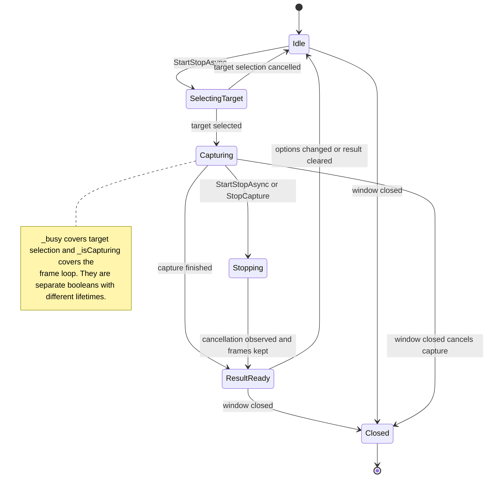

**How it works:**

- `StartStopAsync` returns immediately if closed, stops if already capturing, or runs target selection under `_busy` ([`ScrollingCaptureViewModel.cs:155-194`](../../src/desktop/app/XerahS.UI/ViewModels/ScrollingCaptureViewModel.cs)).
- `SelectAndCaptureAsync` begins the platform scroll input session, selects a target, and calls `CaptureTargetAsync`; the input session is always ended in `finally` ([`ScrollingCaptureViewModel.cs:199-243`](../../src/desktop/app/XerahS.UI/ViewModels/ScrollingCaptureViewModel.cs)).
- `CaptureTargetAsync` sets `IsCapturing`, clears `Status`, runs `ScrollingCaptureManager.CaptureAsync`, assigns the result status, and clears `IsCapturing` in `finally` ([`ScrollingCaptureViewModel.cs:245-321`](../../src/desktop/app/XerahS.UI/ViewModels/ScrollingCaptureViewModel.cs)).
- `StopCapture` only cancels the token and changes the status text; the frame loop decides when to stop ([`ScrollingCaptureViewModel.cs:323-333`](../../src/desktop/app/XerahS.UI/ViewModels/ScrollingCaptureViewModel.cs)).

**Observations:**

- The result state is an enum, but the “selecting”, “stopping”, and “closed” states are booleans. The UI has to combine `IsCapturing`, `HasResult`, `Status`, and `_closed` to decide what to show.
- `_busy` is cleared in a `finally` after target selection; `_isCapturing` is cleared in a different `finally`. A failure between them can leave the controls disabled longer than expected.
- `Cleanup` sets `_closed` and cancels the token; it does not wait for the frame loop ([`ScrollingCaptureViewModel.cs:420-425`](../../src/desktop/app/XerahS.UI/ViewModels/ScrollingCaptureViewModel.cs)).

### 3.11 Persistent mobile upload queue

**Carrier:** `Queue<UploadQueueItem> _queue`, `_isProcessing`, and a `MaxRetryCount` loop.

**Owner:** `UploadQueueService` (singleton).

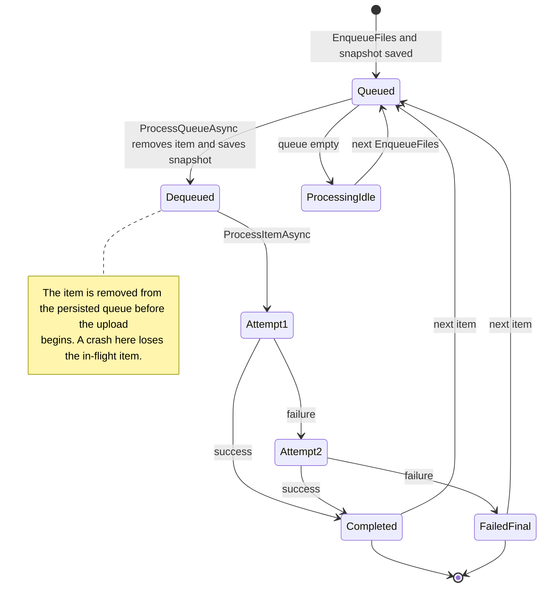

**How it works:**

- `EnqueueFiles` appends items and saves a snapshot; `StartProcessingIfNeeded` sets `_isProcessing` and starts the worker ([`UploadQueueService.cs:89-162`](../../src/desktop/core/XerahS.Core/Services/UploadQueueService.cs)).
- `ProcessQueueAsync` dequeues under the lock and saves the snapshot *before* calling `ProcessItemAsync` ([`UploadQueueService.cs:170-192`](../../src/desktop/core/XerahS.Core/Services/UploadQueueService.cs)).
- `ProcessItemAsync` tries at most `MaxRetryCount` times (currently 2 attempts total), returns a completion event with the URL or the last error, and deletes owned temp files in `finally` ([`UploadQueueService.cs:211-248`](../../src/desktop/core/XerahS.Core/Services/UploadQueueService.cs)).
- `_isProcessing` is reset when the queue is empty or the worker crashes ([`UploadQueueService.cs:196-207`](../../src/desktop/core/XerahS.Core/Services/UploadQueueService.cs)).

**Observations:**

1. **The persisted state is “queued”, not “uploading”.** The snapshot after dequeue does not contain the item currently being uploaded. A process crash during the upload loses it.
2. **Retry count is two attempts, not two retries.** `MaxRetryCount = 2` and the loop increments before each upload ([`UploadQueueService.cs:37-40`](../../src/desktop/core/XerahS.Core/Services/UploadQueueService.cs), [`224-246`](../../src/desktop/core/XerahS.Core/Services/UploadQueueService.cs)).
3. **The queue is sequential.** `_isProcessing` guarantees one worker, but there is no per-item persisted status or checkpoint.

### 3.12 OCR indexing

**Carrier:** in-memory `ConcurrentQueue<HistoryItem>`, `_queuedItemCount`, `_queueWorkerRunning`, and persisted `HistoryOcrIndex.Status` strings.

**Owner:** `OcrIndexingService` for the queue; `HistoryOcrIndexStore` for the persisted state.

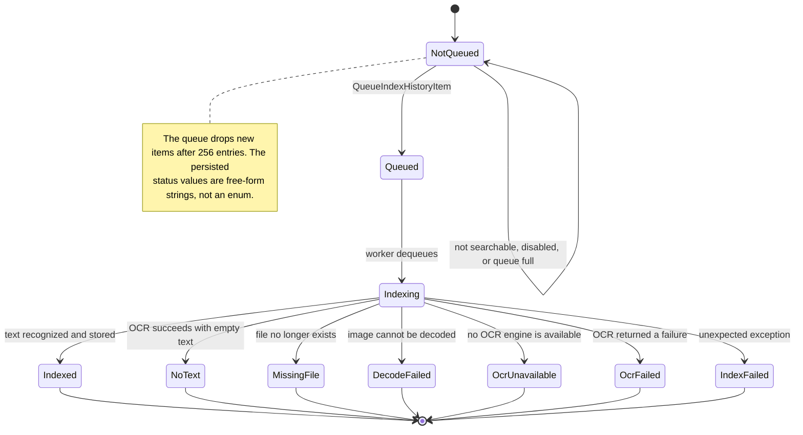

**How it works:**

- `QueueIndexHistoryItem` rejects disabled indexing, invalid IDs, non-images, already-queued IDs, and items over the 256-entry cap ([`OcrIndexingService.cs:51-78`](../../src/desktop/core/XerahS.Core/Services/OcrIndexingService.cs)).
- `StartQueueWorker` uses `Interlocked.CompareExchange` on `_queueWorkerRunning` so only one worker runs ([`OcrIndexingService.cs:80-115`](../../src/desktop/core/XerahS.Core/Services/OcrIndexingService.cs)).
- `IndexHistoryItemAsync` holds `IndexGate`, tries the cached tag first, then OCR, and writes one of several status strings through `MarkStatus` ([`OcrIndexingService.cs:117-176`](../../src/desktop/core/XerahS.Core/Services/OcrIndexingService.cs)).
- `HistoryOcrIndexStore` treats `"indexed"` as the only searchable status; every other value is a terminal or retryable marker with no type safety ([`HistoryOcrIndexStore.cs:46`](../../src/desktop/core/XerahS.History/HistoryOcrIndexStore.cs), [`105-133`](../../src/desktop/core/XerahS.History/HistoryOcrIndexStore.cs)).

**Observations:**

- The status vocabulary is spread across call sites as string literals: `indexed`, `missing_file`, `ocr_unavailable`, `decode_failed`, `no_text`, `ocr_failed`, `index_failed`. There is no enum or validation.
- The 256-item cap silently drops work; the caller only sees a debug log.
- The queue is in-memory, so queued items are lost on exit even though their indexed status may already exist for other items.

## 4. Shell and UI Machines

### 4.1 Update check, download, and install

There are two machines. The first is the check result:

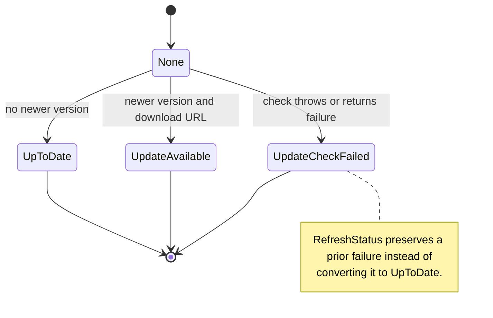

The second is the download window:

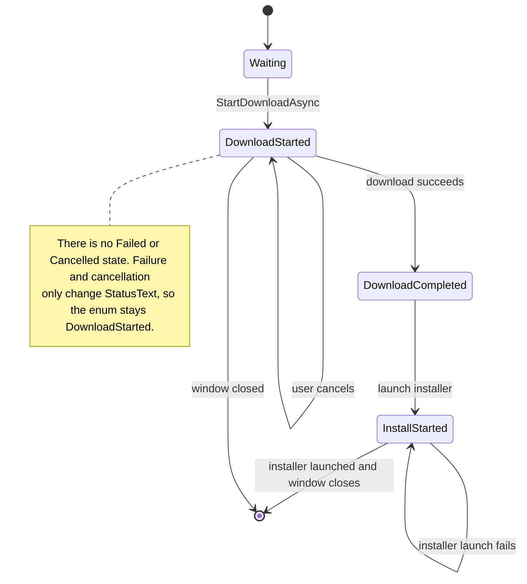

**How it works:**

- `UpdateChecker.RefreshStatus` keeps `UpdateCheckFailed` sticky and otherwise chooses `UpdateAvailable` or `UpToDate` ([`UpdateChecker.cs:65-91`](../../src/desktop/core/XerahS.Common/UpdateChecker/UpdateChecker.cs)).
- `DownloaderWindowViewModel.StartDownloadAsync` only runs from `Waiting`, sets `DownloadStarted`, and moves to `DownloadCompleted` on success ([`DownloaderWindowViewModel.cs:81-135`](../../src/desktop/app/XerahS.UI/ViewModels/DownloaderWindowViewModel.cs)).
- Failure and cancellation only set `StatusText`; they do not change `Status`. `Cancel()` closes the window without a state transition ([`DownloaderWindowViewModel.cs:190-198`](../../src/desktop/app/XerahS.UI/ViewModels/DownloaderWindowViewModel.cs)).
- `LaunchInstallerAsync` sets `InstallStarted`; a launch failure only sets `StatusText` and re-enables `CanCancel` ([`DownloaderWindowViewModel.cs:157-185`](../../src/desktop/app/XerahS.UI/ViewModels/DownloaderWindowViewModel.cs)).
- `UpdateService.ShowUpdateDialogAsync` uses `IsUpdateDialogOpen` to keep one dialog open ([`UpdateService.cs:230-287`](../../src/desktop/app/XerahS.UI/Services/UpdateService.cs)).

**Observations:**

- `DownloadStarted` is both “in progress” and “failed/cancelled”. A caller cannot distinguish them from `Status`.
- `StartDownloadAsync` refuses to run unless the state is `Waiting`, so the same view model cannot retry after a failure.
- `InstallStarted` has no success or failure terminal state; the application is expected to shut down on success, and a launch failure leaves the window in `InstallStarted` with `CanCancel = true`.
- The update check state and the dialog state are separate; `UpdateService` does not record that a check is already running.

### 4.2 Toast lifetime

**Carrier:** `_isDurationEnd`, `_isMouseInside`, `_isMenuOpen`, `_isFileDragActive`, `_isDragging`, `_opacity`, `_durationTimer`, `_fadeTimer`, `_disposed`.

**Owner:** `ToastViewModel` owns the timers and flags; `ToastWindow` owns pointer and menu input.

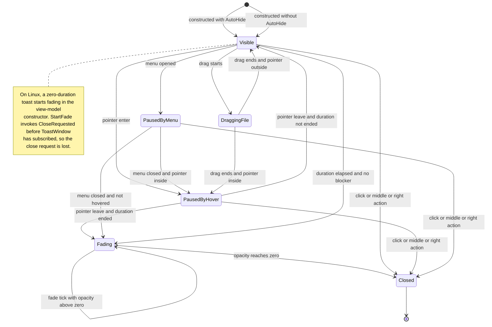

**How it works:**

- The constructor selects `WaitForDuration`, `StartFade`, or `None`; `StartFade` on Linux invokes `CloseRequested` immediately ([`ToastViewModel.cs:213-222`](../../src/desktop/app/XerahS.UI/ViewModels/ToastViewModel.cs), [`431-449`](../../src/desktop/app/XerahS.UI/ViewModels/ToastViewModel.cs)).
- `ToastWindow.Initialize` constructs the view model first and subscribes `CloseRequested` afterwards ([`ToastWindow.axaml.cs:121-125`](../../src/desktop/app/XerahS.UI/Views/ToastWindow.axaml.cs)). That ordering is the source of the lost event.
- `CheckFade` requires duration end, auto-hide, no hover, no menu, and no file drag ([`ToastViewModel.cs:391-404`](../../src/desktop/app/XerahS.UI/ViewModels/ToastViewModel.cs)).
- `OnMenuOpened` stops the fade and restores opacity; `OnMenuClosed` starts the fade immediately when not hovered ([`ToastViewModel.cs:319-343`](../../src/desktop/app/XerahS.UI/ViewModels/ToastViewModel.cs)).
- `OnFileDragStarted` and `OnFileDragEnded` bracket the drag-and-drop operation ([`ToastViewModel.cs:359-373`](../../src/desktop/app/XerahS.UI/ViewModels/ToastViewModel.cs)).
- `AvaloniaToastService` keeps one active toast and closes it before showing the next ([`AvaloniaToastService.cs:80-100`](../../src/desktop/app/XerahS.UI/Services/AvaloniaToastService.cs)).

**Observations:**

1. **Lost close on Linux with a zero display duration.** `ToastConfig.IsValid` allows `Duration = 0` when `FadeDuration > 0`. The view model then calls `CheckFade` in its constructor, `StartFade` closes immediately on Linux, and no subscriber has been attached yet.
2. **Hover, menu, and drag are three separate pause reasons.** They are checked together in `CheckFade`, but they are set and cleared by different classes.
3. **`_isDurationEnd` is set before `CheckFade`.** A user who opens the menu before the duration expires and closes it afterward starts the fade immediately; the comment in `OnMenuClosed` documents that this is deliberate.
4. **The toast service is a single-slot machine.** Showing a new toast is an implicit transition that force-closes the old one; there is no queue.

### 4.3 Assistant conversation

**Carrier:** `IsBusy`, `HasPendingConfirmation`, `_pendingAction`, `HasResultPreview`, `_requestCts`, `_lastEscClearAt`.

**Owner:** `AssistantViewModel`.

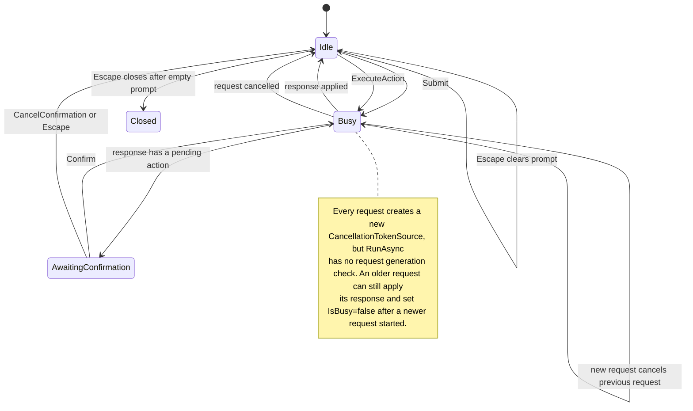

**How it works:**

- `SubmitAsync`, `ExecuteActionAsync`, and `ConfirmAsync` all cancel the previous request, create a new CTS, and call `RunAsync` ([`AssistantViewModel.cs:85-122`](../../src/desktop/app/XerahS.UI/ViewModels/AssistantViewModel.cs)).
- `RunAsync` sets `IsBusy`, applies the response, and clears `IsBusy` in `finally` ([`AssistantViewModel.cs:178-199`](../../src/desktop/app/XerahS.UI/ViewModels/AssistantViewModel.cs)).
- `ApplyResponse` copies items and actions, sets `HasPendingConfirmation` from `response.PendingConfirmation`, and stores `_pendingAction` ([`AssistantViewModel.cs:202-225`](../../src/desktop/app/XerahS.UI/ViewModels/AssistantViewModel.cs)).
- `HandleEscape` cancels a pending confirmation first, then a running request, then clears the prompt; a second Escape within two seconds closes the overlay ([`AssistantViewModel.cs:140-176`](../../src/desktop/app/XerahS.UI/ViewModels/AssistantViewModel.cs)).

**Observations:**

1. **Stale response race.** There is no request ID or generation counter. If request A is cancelled and request B starts, A can still complete and call `ApplyResponse`, replacing B's UI. A's `finally` also sets `IsBusy = false` while B is still running.
2. **`HasPendingConfirmation` and `_pendingAction` are two copies of one fact.** They are set together in `ApplyResponse`, but `_pendingAction` is also cleared separately in `ConfirmAsync` and `CancelConfirmation`.
3. **The confirmation is part of the response, not a separate request state.** A backend that returns a pending action and then fails does not have a defined “confirmation expired” state.

### 4.4 After-capture goal

**Carrier:** `AfterCaptureGoal` (CopyImage, CopyFilePath, CopyUrl) plus the booleans that mirror `AfterCaptureTasks` and `AfterUploadTasks`.

**Owner:** `AfterCaptureViewModel`.

The goal maps to task flags like this:

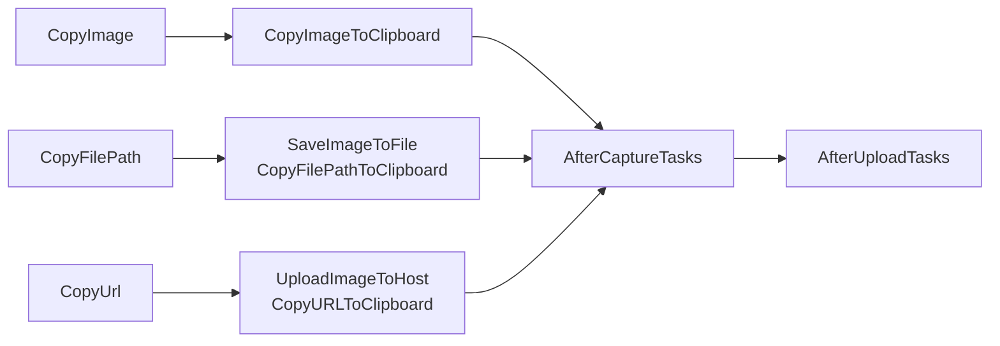

The dialog result is a separate two-state machine:

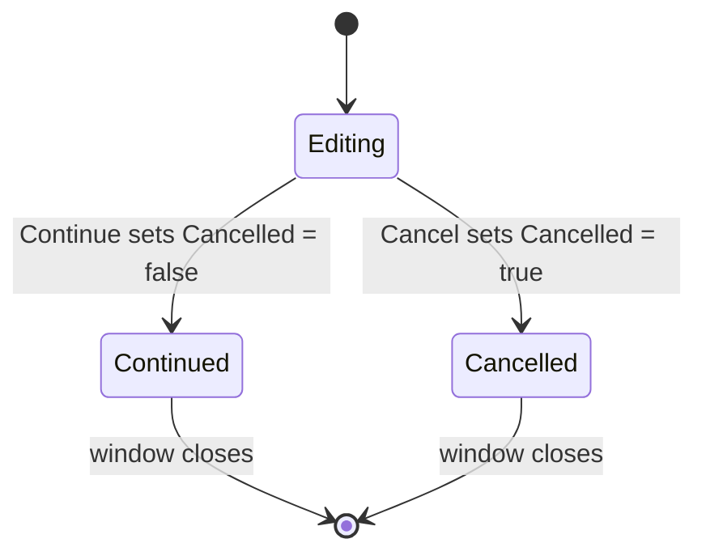

**How it works:**

- The constructor infers a goal from the existing flags and then applies that goal's flags ([`AfterCaptureViewModel.cs:70-84`](../../src/desktop/app/XerahS.UI/ViewModels/AfterCaptureViewModel.cs), [`286-305`](../../src/desktop/app/XerahS.UI/ViewModels/AfterCaptureViewModel.cs)).
- Changing `SelectedGoal` calls `ApplyGoalFlags`, which clears the exclusive capture flags and reapplies the goal's required flags ([`AfterCaptureViewModel.cs:307-355`](../../src/desktop/app/XerahS.UI/ViewModels/AfterCaptureViewModel.cs)).
- Individual boolean setters block clearing the flag required by the current goal, but they allow adding unrelated flags ([`AfterCaptureViewModel.cs:127-225`](../../src/desktop/app/XerahS.UI/ViewModels/AfterCaptureViewModel.cs)).
- `Continue` sets `Cancelled = false`; `Cancel` sets it to `true` before closing ([`AfterCaptureViewModel.cs:273-283`](../../src/desktop/app/XerahS.UI/ViewModels/AfterCaptureViewModel.cs)).

**Observations:**

- The goal and the task flags are two representations of the same decision. `InferGoal` is the only normalization path; any code that mutates the flags directly can make the goal and flags disagree.
- The goal is inferred with a `CopyUrl` fallback when no known flag is set. A configuration with only `SaveImageToFile` is therefore shown as a CopyUrl goal until the user changes it.
- The `Cancelled` flag is the dialog's result, but the window close event is the actual transition. The view model can be closed by the window without either `Continue` or `Cancel` running if the close path changes.

### 4.5 Upload content queue

**Carrier:** per-item `UploadQueueItemStatus` (Pending, Uploading, Completed, Failed) plus mirrored `IsPending` and `IsFailed`; global `IsUploading`, `_uploadCts`, `HasPendingItems`, `HasItems`.

**Owner:** `UploadContentViewModel`.

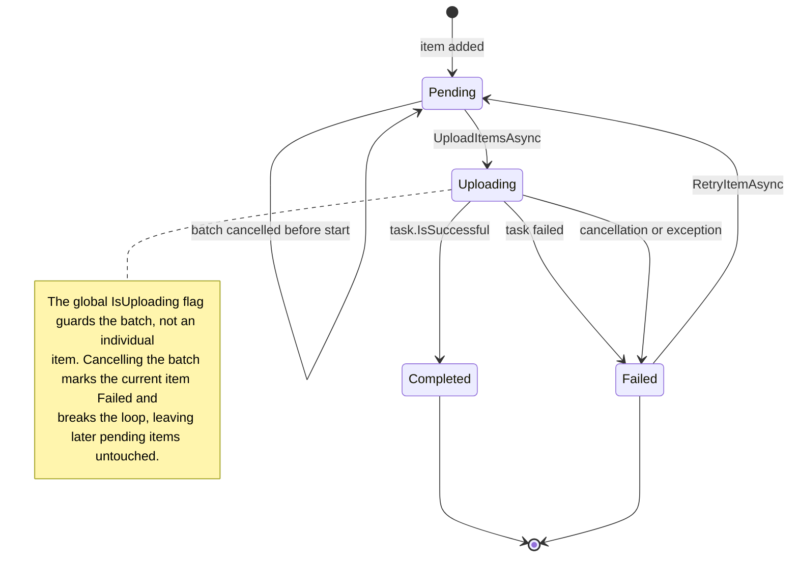

**How it works:**

- `UploadItemsAsync` refuses to run when `IsUploading` is true, sets it, creates a CTS, and processes pending items sequentially ([`UploadContentViewModel.cs:379-407`](../../src/desktop/app/XerahS.UI/ViewModels/UploadContentViewModel.cs)).
- `UploadItemAsync` sets `Uploading`, starts the appropriate task through `IDesktopTaskManager`, and maps task success, failure, cancellation, and exception to `Completed` or `Failed` ([`UploadContentViewModel.cs:408-527`](../../src/desktop/app/XerahS.UI/ViewModels/UploadContentViewModel.cs)).
- `RetryItemAsync` only accepts a `Failed` item and re-queues it as `Pending` ([`UploadContentViewModel.cs:624-634`](../../src/desktop/app/XerahS.UI/ViewModels/UploadContentViewModel.cs)).
- `OnStatusChanged` keeps `IsPending` and `IsFailed` in sync with the enum ([`UploadContentViewModel.cs:87-91`](../../src/desktop/app/XerahS.UI/ViewModels/UploadContentViewModel.cs)).

**Observations:**

- The status enum and the two booleans are three copies of a two-bit state. The partial method keeps them in sync only when the enum changes.
- A cancelled batch marks the in-flight item `Failed` and leaves the remaining pending items as `Pending`; there is no explicit “batch cancelled” state.
- `OnTaskStarted` matches the started task by `TaskSettings` reference, which relies on each item getting a fresh settings object ([`UploadContentViewModel.cs:430-442`](../../src/desktop/app/XerahS.UI/ViewModels/UploadContentViewModel.cs)).

### 4.6 Hotkey registration and recording

There are two related machines: the per-hotkey registration state and the portal backend state.

**Per-hotkey status:** `HotkeyStatus` (NotConfigured, Registered, Failed, UnsupportedPlatform, Recording).

**Declared status:** [`HotkeyInfo.cs:213-220`](../../src/platform/XerahS.Platform.Abstractions/Models/HotkeyInfo.cs)

```mermaid
stateDiagram-v2
    [*] --> NotConfigured
    NotConfigured --> Registered : valid, enabled, no conflict, service accepts
    NotConfigured --> Failed : conflict, or platform sets Failed on rejection
    NotConfigured --> UnsupportedPlatform : platform cannot register
    Registered --> NotConfigured : unregister or clear
    Registered --> Recording : UI enters recording mode
    Recording --> Registered : commit
    Recording --> Registered : cancel, which re-registers the previous keys
    Failed --> NotConfigured : edit or disable
    UnsupportedPlatform --> NotConfigured : platform changes
```

**Portal backend:** `HotkeyBackendState` (Native, PortalPending, PortalBound, X11FallbackFocusOnly, Unavailable).

```mermaid
stateDiagram-v2
    [*] --> Unavailable
    Unavailable --> PortalPending : portal session create
    PortalPending --> PortalBound : BindShortcuts succeeds
    PortalPending --> X11FallbackFocusOnly : bind cancelled or failed
    PortalBound --> PortalPending : rebind scheduled
    PortalBound --> X11FallbackFocusOnly : portal lost or bind fails
    X11FallbackFocusOnly --> PortalBound : portal bind succeeds later
    X11FallbackFocusOnly --> Unavailable : fallback cannot start
    PortalBound --> Unavailable : dispose
```

**How it works:**

- `WorkflowManager.RegisterHotkey` unregisters an existing mapping, rejects `None`, disabled, invalid, and conflicting workflows, then asks the platform service to register ([`WorkflowManager.cs:127-220`](../../src/desktop/core/XerahS.Core/Hotkeys/WorkflowManager.cs)).
- `HotkeysDisabled` is the user-facing “Disable hotkeys” job; `IgnoreHotkeys` delegates to `IHotkeyService.IsSuspended` and is used while recording a new key ([`WorkflowManager.cs:51-58`](../../src/desktop/core/XerahS.Core/Hotkeys/WorkflowManager.cs), [`82-95`](../../src/desktop/core/XerahS.Core/Hotkeys/WorkflowManager.cs)).
- The portal service tracks session creation, bind success, fallback activation, rebind debounce, and suspension in fields rather than one enum ([`WaylandPortalHotkeyService.cs:59-69`](../../src/platform/XerahS.Platform.Linux/Services/WaylandPortalHotkeyService.cs), [`312-342`](../../src/platform/XerahS.Platform.Linux/Services/WaylandPortalHotkeyService.cs)).
- `HotkeySelectionControl` has an explicit `ControlMode` (Normal, Recording); `HotkeyRecorder`, `HotkeyStepViewModel`, and `WorkflowEditorView` each implement the same recording state separately.

**Observations:**

1. **Two `HotkeyStatus` enums exist.** `XerahS.Common.HotkeyStatus` has three values and is only used by the unused `CommonHotkeyInfo`; `XerahS.Platform.Abstractions.HotkeyStatus` has five values and is the live one ([`Common/Enums.cs:150-155`](../../src/desktop/core/XerahS.Common/Enums.cs), [`HotkeyInfo.cs:213-220`](../../src/platform/XerahS.Platform.Abstractions/Models/HotkeyInfo.cs)).
2. **Two “off” switches exist.** `HotkeysDisabled` ignores triggers in `WorkflowManager`; `IgnoreHotkeys` suspends the platform service. They are set in different places and have different failure modes.
3. **Cancel re-registers.** `HotkeySelectionControl.CancelRecording` restores the old key and calls `StopRecording`, which re-registers if `RegisterOnCommit` is set ([`HotkeySelectionControl.axaml.cs:389-411`](../../src/desktop/app/XerahS.UI/Views/Controls/HotkeySelectionControl.axaml.cs)). Cancel and commit share the same terminal path.
4. **Four recording implementations.** `HotkeySelectionControl`, `HotkeyRecorder`, `HotkeyStepViewModel`, and `WorkflowEditorView` each track “recording a hotkey” with their own boolean or enum.

### 4.7 App and window lifecycle

**Carrier:** `App.IsExiting`, `App.StartedInTray`, `_silentRunHideApplied`, `_onboardingShown`, `_isOpenImageInProgress`, and the unused `ILifecycleService.IsShuttingDown`.

```mermaid
stateDiagram-v2
    [*] --> Starting
    Starting --> UiReady : framework initialization completes
    UiReady --> TrayHidden : StartedInTray
    UiReady --> MainVisible : normal start
    TrayHidden --> MainVisible : open main window
    MainVisible --> TrayHidden : close with tray available
    MainVisible --> Exiting : close without tray
    TrayHidden --> Exiting : tray Exit
    MainVisible --> Exiting : update installer or auto-close
    TrayHidden --> Exiting : update installer or auto-close
    Exiting --> [*] : desktop.Shutdown

    note right of TrayHidden
        App.IsExiting is the effective shutdown flag. The registered
        ILifecycleService.IsShuttingDown field is never read.
    end note
```

**How it works:**

- `StartedInTray` is computed once from the silent-run setting, the `-silent`/`-s` argument, and the tray-icon availability ([`App.axaml.cs:250-261`](../../src/desktop/app/XerahS.UI/App.axaml.cs), [`SilentRunStartupPolicy.cs:50-54`](../../src/desktop/app/XerahS.UI/Helpers/SilentRunStartupPolicy.cs)).
- `MainWindow.OnWindowOpened` hides the window once when `ShouldHideMainWindowToTray` is true ([`MainWindow.axaml.cs:453-458`](../../src/desktop/app/XerahS.UI/Views/MainWindow.axaml.cs)).
- `OnClosing` cancels the close and hides to the tray when `HidesToTrayOnClose` is true; otherwise the window closes and the desktop lifetime exits ([`MainWindow.axaml.cs:575-590`](../../src/desktop/app/XerahS.UI/Views/MainWindow.axaml.cs), [`SilentRunStartupPolicy.cs:63-67`](../../src/desktop/app/XerahS.UI/Helpers/SilentRunStartupPolicy.cs)).
- `UpdateService`, `WorkflowOrchestrator`, and `TrayIconHelper` set `App.IsExiting = true` before calling `desktop.Shutdown()` ([`UpdateService.cs:339-345`](../../src/desktop/app/XerahS.UI/Services/UpdateService.cs), [`WorkflowOrchestrator.cs:110-117`](../../src/desktop/app/XerahS.UI/Services/WorkflowOrchestrator.cs), [`TrayIconHelper.cs:795-800`](../../src/desktop/app/XerahS.UI/TrayIconHelper.cs)).
- `AvaloniaLifecycleService` has its own `_isShuttingDown` and `RequestShutdown`, but nothing calls them ([`AvaloniaLifecycleService.cs:39-66`](../../src/desktop/app/XerahS.UI/Services/AvaloniaLifecycleService.cs), [`ILifecycleService.cs:39-47`](../../src/desktop/core/XerahS.Services.Abstractions/ILifecycleService.cs)).

**Observations:**

- `App.IsExiting` and `ILifecycleService.IsShuttingDown` are duplicate shutdown states; only the former is used.
- `_silentRunHideApplied`, `_onboardingShown`, and `_isOpenImageInProgress` are one-shot UI latches with no reset path. That is fine for a single window lifetime but makes the window non-reusable.
- Closing the main window has three outcomes (hide, exit, cancel by OS shutdown) that are decided in one predicate; the enum-like reasons are not represented in the window state.

### 4.8 Watch folders

**Carrier:** `_acceptNewFiles`, `_activeProcessingCount`, `_inFlight`, `_isDisposed`, and the watcher list.

```mermaid
stateDiagram-v2
    [*] --> Stopped
    Stopped --> Running : StartOrReloadFromCurrentSettings
    Running --> Reloading : UpdateWatchers
    Reloading --> Running : watchers rebuilt
    Running --> Draining : StopAsync
    Draining --> Stopped : active count reaches zero
    Draining --> Stopped : timeout expires
    Running --> Stopped : Stop
    Stopped --> Disposed : Dispose
    Running --> Disposed : Dispose
    Disposed --> Running : StartOrReloadFromCurrentSettings without a guard

    note right of Draining
        StopAsync waits for _activeProcessingCount only. A file event
        that has been queued but has not yet incremented the count is
        not waited for.
    end note
```

**How it works:**

- `UpdateWatchers` sets `_acceptNewFiles = false`, stops and disposes the watchers, sets `_acceptNewFiles = true`, then creates the new watchers ([`WatchFolderManager.cs:52-78`](../../src/desktop/core/XerahS.Core/Managers/WatchFolderManager.cs)).
- `OnFileDetected` rejects new files when `_acceptNewFiles` is false, deduplicates through `_inFlight`, and starts a task that increments `_activeProcessingCount` inside the task ([`WatchFolderManager.cs:106-135`](../../src/desktop/core/XerahS.Core/Managers/WatchFolderManager.cs)).
- `Stop` sets `_acceptNewFiles = false` and stops watchers; `StopAsync` does the same and waits for the active count ([`WatchFolderManager.cs:440-465`](../../src/desktop/core/XerahS.Core/Managers/WatchFolderManager.cs)).
- `Dispose` stops the watchers and sets `_isDisposed`, but does not clear `_acceptNewFiles` or wait for in-flight work ([`WatchFolderManager.cs:487-493`](../../src/desktop/core/XerahS.Core/Managers/WatchFolderManager.cs)).

**Observations:**

1. **Stop is not durable.** `UpdateWatchers` sets `_acceptNewFiles` back to true, so a reload after `Stop` restarts watching without an explicit start.
2. **Dispose is not terminal.** `StartOrReloadFromCurrentSettings` does not check `_isDisposed`; a disposed manager can create new watchers.
3. **Drain counts started work only.** `_inFlight` includes files that are queued but not yet running, but `StopAsync` waits only on `_activeProcessingCount`, which is incremented inside the task. A queued event can be missed by the drain.
4. **Two deduplication checks.** The original path is in `_inFlight`; a converted MP4 path is added to `_inFlight` again and removed in the inner `finally` ([`WatchFolderManager.cs:138-212`](../../src/desktop/core/XerahS.Core/Managers/WatchFolderManager.cs)).

### 4.9 Cloud OAuth, session, and publish

**OAuth attempt state:** pending entries plus a `_consumed` set and a waiter dictionary.

```mermaid
stateDiagram-v2
    [*] --> Pending : Begin
    Pending --> Accepted : callback code exchanged and session stored
    Pending --> Denied : callback error
    Pending --> Expired : attempt expired or wait timeout
    Pending --> TokenRejected : exchange or validation failure
    Pending --> UnknownOrReplayed : consumed or missing state
    Pending --> InvalidCallback : malformed callback, attempt stays pending
    InvalidCallback --> Pending : attempt remains available
    Accepted --> Consumed : state recorded
    Denied --> Consumed
    Expired --> Consumed
    TokenRejected --> Consumed
    UnknownOrReplayed --> Consumed : when the state was already consumed

    note right of Consumed
        Consumed is a ConcurrentDictionary entry that is never removed.
        A cancellation during token exchange removes the pending entry
        but does not complete the waiter, which then waits for the timeout.
    end note
```

**Session state:** `IXerahSCloudSessionStore.Current` plus the refresh credential.

```mermaid
stateDiagram-v2
    [*] --> NoCredential
    NoCredential --> Valid : OAuth accepted
    Valid --> Refreshing : expiry within one minute or HTTP 401
    Refreshing --> Valid : refresh accepted
    Refreshing --> Cleared : security rejection or account switch
    Valid --> Cleared : SignOut
    Cleared --> NoCredential
    Valid --> [*]
```

**Publish and delete state:** encoded in history tags, not a type.

```mermaid
stateDiagram-v2
    [*] --> Unpublished
    Unpublished --> Publishing : PublishItemAsync
    Publishing --> Published : server returns id and owner
    Publishing --> Unpublished : failure
    Published --> Unpublishing : UnpublishItemAsync
    Unpublishing --> Unpublished : removed
    Unpublishing --> Unpublished : accepted pending
    Published --> [*]
    Unpublished --> [*]

    note right of Unpublishing
        UnpublishAsync can return Removed or AcceptedPending, but
        HistoryViewModel discards the result and marks the item
        unpublished either way.
    end note
```

**How it works:**

- `Begin` creates an attempt, stores it in `_pending`, and creates a waiter ([`XerahSCloudOAuth.cs:183-219`](../../src/desktop/core/XerahS.Core/Cloud/XerahSCloudOAuth.cs)).
- `WaitForCompletionAsync` waits with `AttemptLifetime`; a timeout removes the pending entry, removes the waiter, and marks the state consumed ([`XerahSCloudOAuth.cs:222-243`](../../src/desktop/core/XerahS.Core/Cloud/XerahSCloudOAuth.cs)).
- `CompleteAsync` rejects consumed or missing states, exchanges the code, stores the session, and completes the waiter ([`XerahSCloudOAuth.cs:245-295`](../../src/desktop/core/XerahS.Core/Cloud/XerahSCloudOAuth.cs)).
- `XerahSCloudApiClient.GetSessionAsync` refreshes under a semaphore, accepts the refreshed session, and clears the store on a security rejection or owner change ([`XerahSCloudApiClient.cs:268-312`](../../src/desktop/core/XerahS.Core/Cloud/XerahSCloudApiClient.cs)).
- `PublishItemAsync` writes `Published`, `PublishedId`, and `PublishedOwnerId` tags; `UnpublishItemAsync` writes `Unpublished` ([`HistoryViewModel.cs:814-962`](../../src/desktop/app/XerahS.UI/ViewModels/HistoryViewModel.cs), [`HistoryPublishMetadata.cs:45-117`](../../src/desktop/core/XerahS.History/HistoryPublishMetadata.cs)).

**Observations:**

1. **`_consumed` grows without bound.** It is only ever added to, never pruned. That is small per attempt, but it is a permanent state set in a long-running process.
2. **Cancellation leaves a waiter pending.** `CompleteAsync` catches only cloud, HTTP, and JSON exceptions. An `OperationCanceledException` from the exchange removes the pending entry and adds the state to `_consumed`, but the waiter is not completed, so it waits for the full attempt lifetime.
3. **`AcceptedPending` is collapsed into “unpublished”.** The server can accept a deletion asynchronously, but the UI immediately removes the published tags.
4. **Session refresh is a state machine hidden behind a lock.** `GetSessionAsync` has “valid”, “refresh”, “cleared”, and “retry once after 401” paths but no explicit state or return type for “refresh failed”.
5. **Auth and publish are separate machines.** A publish can trigger OAuth sign-in from inside its own request path, so the publish state and the OAuth state overlap.

### 4.10 Onboarding wizard

**Carrier:** `CurrentStepIndex`, `Steps`, `SkippedSteps`, `LastCompletedStepIndex`, `_completionSource`, `CanGoBack`, `IsLastStep`.

```mermaid
stateDiagram-v2
    [*] --> Welcome
    Welcome --> SaveLocation : Next
    Welcome --> SaveLocation : Skip
    SaveLocation --> Hotkeys : Next
    SaveLocation --> Hotkeys : Skip
    Hotkeys --> Upload : Next
    Hotkeys --> Upload : Skip
    Upload --> Complete : Next
    Upload --> Complete : Skip
    Complete --> Completed : Done
    Welcome --> Cancelled : Cancel
    SaveLocation --> Cancelled : Cancel
    Hotkeys --> Cancelled : Cancel
    Upload --> Cancelled : Cancel
    Complete --> Cancelled : Cancel
    Completed --> [*]
    Cancelled --> [*]

    note right of SaveLocation
        Back moves to the previous step. SkippedSteps is a parallel
        set that records which steps were skipped, independently of
        the current index. SkipAll jumps from the current step to Complete.
    end note
```

**How it works:**

- `Next` validates the current step, saves it to `OnboardingState`, and either completes the wizard or increments the index ([`OnboardingWizardViewModel.cs:120-143`](../../src/desktop/app/XerahS.UI/Onboarding/OnboardingWizardViewModel.cs)).
- `Back` saves the current step and decrements the index; `Skip` marks the step skipped and advances; `SkipAll` marks every remaining step skipped and completes ([`OnboardingWizardViewModel.cs:145-186`](../../src/desktop/app/XerahS.UI/Onboarding/OnboardingWizardViewModel.cs)).
- `CompleteWizardAsync` saves the final state, sets `LastCompletedStepIndex`, commits settings, and completes the `TaskCompletionSource` once ([`OnboardingWizardViewModel.cs:212-229`](../../src/desktop/app/XerahS.UI/Onboarding/OnboardingWizardViewModel.cs)).
- `Cancel` completes the same source with `Completed = false` ([`OnboardingWizardViewModel.cs:370-378`](../../src/desktop/app/XerahS.UI/Onboarding/OnboardingWizardViewModel.cs)).

**Observations:**

- The wizard is index-driven, not state-driven. `CurrentStepIndex` is the state; `SkippedSteps` and `LastCompletedStepIndex` are parallel histories.
- `CanGoBack` and `IsLastStep` are derived from the index, so they cannot be wrong independently.
- The completion source is one-shot; a second `CompleteAsync` or `Cancel` is ignored after the first.

### 4.11 Plugin installer

**Carrier:** `_hasLoadedCommunityPlugins`, `IsLoadingCommunityPlugins`, `IsInstalling`, `Manifest`, `PackageFilePath`, `ErrorMessage`, `StatusMessage`, `SelectedCommunityPlugin`.

```mermaid
stateDiagram-v2
    [*] --> Idle
    Idle --> LoadingRegistry : InitializeAsync
    LoadingRegistry --> RegistryLoaded : fetch succeeds
    LoadingRegistry --> RegistryLoaded : fetch fails with error message
    RegistryLoaded --> PackagePreview : LoadPackageAsync
    PackagePreview --> Installing : Install
    RegistryLoaded --> Installing : InstallCommunityPlugin
    Installing --> Installed : install succeeds and catalog reloads
    Installing --> PackagePreview : install fails
    Installed --> [*]
    PackagePreview --> [*]

    note right of Installing
        IsInstalling also disables package selection. There is no
        cancellation state for an install that is already running.
    end note
```

**How it works:**

- `InitializeAsync` returns immediately if the registry was already loaded or is loading; it then calls `RefreshCommunityPlugins` ([`PluginInstallerViewModel.cs:128-136`](../../src/desktop/app/XerahS.UI/ViewModels/PluginInstallerViewModel.cs)).
- `LoadPackageAsync` reads the package manifest and sets `Manifest` and `StatusMessage`; invalid packages set `ErrorMessage` ([`PluginInstallerViewModel.cs:138-218`](../../src/desktop/app/XerahS.UI/ViewModels/PluginInstallerViewModel.cs)).
- `Install` and `InstallCommunityPlugin` set `IsInstalling`, install through `PluginPackager`, reload the provider catalog, and clear `IsInstalling` in `finally` ([`PluginInstallerViewModel.cs:220-357`](../../src/desktop/app/XerahS.UI/ViewModels/PluginInstallerViewModel.cs)).
- `RefreshCommunityPlugins` sets `IsLoadingCommunityPlugins`, fetches, updates the collection, and clears the flag in `finally` ([`PluginInstallerViewModel.cs:257-291`](../../src/desktop/app/XerahS.UI/ViewModels/PluginInstallerViewModel.cs)).

**Observations:**

- `IsInstalling` and `IsLoadingCommunityPlugins` are separate busy states that both disable different commands. `CanInstall` checks only `IsInstalling`; `CanRefreshCommunityPlugins` checks both.
- There is no cancellation or rollback state; a failed install returns to the previous preview state with an error string.

### 4.12 Network monitor

**Carrier:** `IsMonitoring`, `IsConnected`, `HasConnectionState`, `_isFirstEvent`, `_failCount`, `_firstFailDate`, `DisconnectCount`, `LastSample`; the host adds `_outageOpen` and `_lastDownNotice`.

```mermaid
stateDiagram-v2
    [*] --> Unknown
    Unknown --> Connected : first successful probe
    Unknown --> Disconnected : first failure threshold reached
    Connected --> Disconnected : failure count reaches threshold
    Disconnected --> Connected : successful probe
    Connected --> Paused : Stop
    Disconnected --> Paused : Stop
    Paused --> Connected : Start and successful probe
    Paused --> Disconnected : Start and failure threshold

    note right of Unknown
        _isFirstEvent distinguishes “no baseline yet” from a real
        connected or disconnected state. It is not an enum member.
    end note
```

The outage log is a second two-state machine:

```mermaid
stateDiagram-v2
    [*] --> OutageClosed
    OutageClosed --> OutageOpen : disconnected event
    OutageOpen --> OutageClosed : connected event
    OutageOpen --> OutageOpen : still-down sample after the interval
    OutageClosed --> OutageClosed : connected samples
```

**How it works:**

- `Start` and `Stop` flip `IsMonitoring` under `_sync` and start or cancel the probe loop ([`InternetConnectionMonitor.cs:105-146`](../../src/desktop/core/XerahS.Common/NetworkMonitor/InternetConnectionMonitor.cs)).
- `CheckOnceAsync` increments `_failCount` on failure and sets `IsConnected` only after `failThreshold` consecutive failures; success resets the count and raises a connected event only when the previous state was disconnected ([`InternetConnectionMonitor.cs:149-252`](../../src/desktop/core/XerahS.Common/NetworkMonitor/InternetConnectionMonitor.cs)).
- `NetworkMonitorHost.OnStatusChanged` toggles `_outageOpen` and writes the down/up log line; `OnSampleReceived` writes the periodic still-down line ([`NetworkMonitorHost.cs:127-159`](../../src/desktop/core/XerahS.Common/NetworkMonitor/NetworkMonitorHost.cs)).

**Observations:**

- The hysteresis state (`_failCount`, `_firstFailDate`, `_isFirstEvent`) is the actual machine; `IsConnected` is only the visible outcome.
- `HasConnectionState` is derived from `!_isFirstEvent`, so “unknown” is not a stored state.
- The host’s outage state is independent of the monitor’s connection state; a restart of the monitor does not reset `_outageOpen` automatically.

### 4.13 Single instance

**Carrier:** `IsSingleInstance`, `IsFirstInstance`, `ownsMutex`, `mutex`, `lockFileStream`, `cts`, `RedirectError`, and the pipe/socket names.

```mermaid
flowchart TD
    A([Process start]) --> B{Acquire mutex and lock file}
    B -->|both acquired| C[First instance]
    B -->|either already held| D[Second instance]
    B -->|one acquired, one unavailable| E[Degraded first instance]
    B -->|both unavailable| F[Fallback first instance]
    C --> G{Unix socket already listening?}
    G -->|yes| D
    G -->|no| H[Listen for pipe connections]
    D --> I{Can connect to first instance?}
    I -->|yes| J[Send arguments and exit]
    I -->|no| K[Record RedirectError and exit]
    E --> H
    F --> H
    H --> L([Run application])
    J --> M([Exit second instance])
    K --> M
```

**How it works:**

- `TryAcquirePrimaryLock` treats “already held” as a second instance, but proceeds as first when one of the two lock mechanisms is unavailable ([`SingleInstanceManager.cs:433-465`](../../src/desktop/core/XerahS.Common/SingleInstanceManager.cs)).
- If both mechanisms are unavailable, it also proceeds as first, which allows more than one instance in a degraded environment.
- On Unix, the constructor probes the socket before listening; a listener means another instance is already running, and a legacy socket can receive the arguments ([`SingleInstanceManager.cs:101-137`](../../src/desktop/core/XerahS.Common/SingleInstanceManager.cs)).
- `RedirectArgumentsToFirstInstance` records `RedirectError` if the hand-off fails ([`SingleInstanceManager.cs:605-630`](../../src/desktop/core/XerahS.Common/SingleInstanceManager.cs)).

**Observations:**

- “First”, “second”, “degraded first”, and “fallback first” are four states collapsed into two booleans.
- The lock result enum is private and local to acquisition; the rest of the class uses `IsFirstInstance` only.
- A stale Unix socket is removed only after the lock and listener checks, so the order of socket and lock checks matters.

## 5. Bundled Editor

### 5.1 Editor pointer interaction

**Carrier:** `_isDrawing`, `_isCreatingEffect`, `_isMovingShapeDuringCreation`, `_wasCtrlHeldDuringDraw`, `_cropActive`, `_isDraggingCropHandle`, `_cutOutDirection`, and the zoom controller’s panning/zooming flags.

```mermaid
stateDiagram-v2
    [*] --> Idle
    Idle --> DrawingShape : pointer press with a drawing tool
    Idle --> CreatingEffect : pointer press with an effect tool
    Idle --> TextEditing : pointer press with the text tool
    Idle --> CropPending : pointer press with the crop tool
    Idle --> Panning : middle button or pan gesture
    Idle --> Zooming : wheel or zoom gesture
    DrawingShape --> Idle : pointer release
    DrawingShape --> MovingShapeDuringCreation : Ctrl held while drawing
    MovingShapeDuringCreation --> DrawingShape : Ctrl released
    CreatingEffect --> Idle : pointer release or effect applied
    TextEditing --> Idle : focus lost or text committed
    CropPending --> DraggingCropHandle : handle press
    DraggingCropHandle --> CropPending : handle released
    CropPending --> Idle : confirm or cancel
    DraggingCropHandle --> Idle : confirm or cancel
    Panning --> Idle : pan release
    Zooming --> Idle : zoom gesture ends

    note right of CropPending
        Right-click cancels an active crop or cut-out. Tool changes
        and window close reset the same flags in several methods.
    end note
```

**How it works:**

- `OnCanvasPointerPressed` dispatches by active tool and button, handling middle-button pan, right-button cancel, crop, effects, text, and drawing paths in one method ([`EditorInputController.cs:127-570`](../../ShareX.ImageEditor/src/ShareX.ImageEditor/Presentation/Controllers/EditorInputController.cs)).
- `OnCanvasPointerMoved` updates the current shape, crop handles, effect previews, and panning; `OnCanvasPointerReleased` finalizes the shape or crop ([`EditorInputController.cs:574-1010`](../../ShareX.ImageEditor/src/ShareX.ImageEditor/Presentation/Controllers/EditorInputController.cs)).
- `TryConfirmCrop`, `CancelCrop`, `HideCropHandles`, `ResetCropDragState`, and `PerformCrop` form the crop terminal paths ([`EditorInputController.cs:1080-1215`](../../ShareX.ImageEditor/src/ShareX.ImageEditor/Presentation/Controllers/EditorInputController.cs)).

**Observations:**

- The interaction is a true multi-mode machine, but it has no state enum; the mode is the active tool plus five booleans.
- Crop has its own sub-state (`_cropActive`, `_isDraggingCropHandle`, handle tag, drag start rect) and its own confirm button.
- Flags are reset in several terminal methods and on tool changes; a missed reset leaves the editor thinking a crop or draw is still active.

### 5.2 Editor document session

**Carrier:** `IsDirty`, `IsModalOpen`, `TaskResult`, `_showStartScreen`, `_disposed`.

```mermaid
stateDiagram-v2
    [*] --> StartScreen
    StartScreen --> Editing : image loaded
    Editing --> Dirty : annotation or image change
    Dirty --> Editing : save succeeds
    Editing --> ConfirmExit : RequestClose while dirty
    Dirty --> ConfirmExit : RequestClose while dirty
    ConfirmExit --> Editing : Cancel
    ConfirmExit --> Closed : Discard
    ConfirmExit --> Saving : Save
    Saving --> Closed : save returns
    Editing --> Closed : RequestClose while clean
    Closed --> [*]

    note right of Saving
        SaveAndCloseAfterConfirmationAsync awaits RequestSaveAsync and
        then closes even when the save returned null.
    end note
```

**How it works:**

- `RequestClose` refuses to close while a modal is open unless `ignoreModal` is set; it sets `TaskResult = Cancel`, then either shows the dirty confirmation or raises `CloseRequested` ([`MainViewModel.cs:177-200`](../../ShareX.ImageEditor/src/ShareX.ImageEditor/Presentation/ViewModels/MainViewModel.cs)).
- `ShowConfirmationDialog` offers Save (then close), Discard (close), or Cancel (stay) ([`MainViewModel.cs:214-241`](../../ShareX.ImageEditor/src/ShareX.ImageEditor/Presentation/ViewModels/MainViewModel.cs)).
- `SaveAndCloseAfterConfirmationAsync` awaits `RequestSaveAsync`, closes the modal, and raises `CloseRequested` unconditionally ([`MainViewModel.cs:243-250`](../../ShareX.ImageEditor/src/ShareX.ImageEditor/Presentation/ViewModels/MainViewModel.cs)).
- `IsDirty` is set from annotation/image changes ([`MainViewModel.cs:530`](../../ShareX.ImageEditor/src/ShareX.ImageEditor/Presentation/ViewModels/MainViewModel.cs)).

**Observations:**

- The document state is split between the editor view model, the `EditorCore`, and the window host.
- The close confirmation is a modal state that overlaps the document state; `TaskResult` is set to `Cancel` before the user has decided.
- A failed or cancelled save still closes the editor. If saving is meant to be a gate, the close should depend on the save result.

## 6. Cross-Cutting Findings

### 6.1 Duplicate state is the biggest systemic issue

- `RecordingStatus` is copied in `ScreenRecordingManager`, `RecordingViewModel`, `TrayIconHelper`, and `RecordingControlWindow`.
- `TaskStatus` (enum) and `TaskInfo.Status` (string) coexist. The string is only used by the download processor.
- `HotkeyStatus` exists twice. `Common.HotkeyStatus` is dead; `Platform.Abstractions.HotkeyStatus` is live.
- `HotkeysDisabled` and `IgnoreHotkeys` are two “off” switches with different behavior.
- `App.IsExiting` and `ILifecycleService.IsShuttingDown` are duplicate shutdown flags; the latter is registered but never read.
- `ScreenRecordState` and `ScreenRecordingStatus` are duplicated in two projects and unused by the live recording path.

### 6.2 Several machines have no terminal failure state

- `DownloaderFormStatus` has no `Failed` or `Cancelled`; a failed download remains `DownloadStarted`.
- `UpdateStatus` has a failure state for the check, but the download window does not.
- `SelectionStateMachine` has terminal `Confirmed` and `Cancelled`, but neither is guarded.
- `WatchFolderManager` has no terminal `Disposed` state that prevents restart.
- `ToastViewModel` has a `Closed` event but no `Closed` flag; the window disposal is the real terminal state.

### 6.3 Transitions are not guarded centrally

- `WorkerTask.Stop()` reads `IsBusy` and writes `Stopping` outside the lifetime lock.
- `ScreenRecordingManager.StartRecordingAsync` mutates session flags before waiting on `_stopSemaphore`.
- `SelectionStateMachine.TransitionTo` accepts any target.
- `WatchFolderManager.UpdateWatchers` re-enables file acceptance after `Stop`.
- `HotkeySelectionControl.CancelRecording` reaches the same terminal path as commit and re-registers the hotkey.

### 6.4 Async completion is not fenced

- `AssistantViewModel.RunAsync` has no request-generation check; an old response can overwrite a newer request.
- `AutoCaptureViewModel.OnCaptureTimerElapsed` is `async void` with no in-flight guard.
- `ToastViewModel` can fire `CloseRequested` before the window subscribes.
- `XerahSCloudOAuth.CompleteAsync` can leave a waiter pending when the exchange is cancelled.
- `UploadQueueService` removes an item from the persisted queue before the upload finishes.

### 6.5 Persisted state is sometimes free-form

- OCR indexing uses status strings (`indexed`, `missing_file`, `no_text`, `ocr_failed`, `index_failed`, etc.).
- Cloud publish uses history tags (`Published`, `PublishedId`, `PublishedOwnerId`).
- Remote deletion uses a `RemoteDeletedAt` tag.
- These are real lifecycles, but there is no schema, no enum, and no transition validation.

## 7. Recommended First Refactors

1. **`WorkerTask`**
   Create one `TaskState` with a guarded transition method, one owner, and no `History` state. Reconcile `TaskInfo.Status` with the enum or delete the string. Add a test that calls `Stop()` concurrently with completion and asserts one terminal state.

2. **`ScreenRecordingManager`**
   Split `SessionState` (inactive, preparing, waiting, active, finalizing, finished, failed) from `TakeState` (none, starting, recording, paused, discarding, restarting). Make `IsRecording` mean “frames are being recorded” and add a separate `IsSessionActive`. Move the start-after-stop check inside the same semaphore that stop holds.

3. **`WatchFolderManager`**
   Add an explicit `Stopped/Running/Draining/Disposed` state. Make `Dispose` terminal, make `Stop` durable across reloads, and drain queued `_inFlight` entries as well as started work.

4. **`ToastViewModel` and `ToastWindow`**
   Give the window one visible/paused/fading/closed state. Start timers after `CloseRequested` is subscribed, or pass the close action into the view model. Keep hover, menu, and drag as pause reasons on that one state.

5. **`AssistantViewModel`**
   Give each request a generation ID or local state object. Only the current generation is allowed to call `ApplyResponse` or clear `IsBusy`.

## 8. Test Coverage Notes

Existing tests already cover parts of the machines:

- `SelectionStateMachineTests`
- `UploadQueueTests`
- `RecordingSessionTests`
- `RecordingRestartTests`
- `WatchFolderManagerStopAsyncTests`
- `ToastWindowClickRoutingTests`
- `WorkflowManagerTests`
- `UploadQueueServiceOwnedTempTests`
- `WorkerTaskImageLifetimeTests`

The gaps that matter most are the races and terminal paths, not the happy paths:

- `WorkerTask.Stop()` racing with the completion `finally`.
- `ScreenRecordingManager` start racing with the tail of a stop.
- `WatchFolderManager.StopAsync` with a queued-but-not-started file event.
- `ToastViewModel` zero-duration close before subscription.
- `AssistantViewModel` stale response after a newer request.
- `XerahSCloudOAuth` cancellation during token exchange.

## 9. Appendix: File Map

| Concern | Files |
|---|---|
| Task lifecycle | `src/desktop/core/XerahS.Core/Tasks/WorkerTask.cs`, `WorkerTaskCapture.cs`, `WorkerTaskRecording.cs`, `Tasks/Pipeline/*` |
| Upload admission | `src/desktop/core/XerahS.Core/Managers/UploadQueue.cs`, `Tasks/TaskStart.cs`, `Managers/TaskManager.cs` |
| Upload confirmation | `src/desktop/core/XerahS.Core/Tasks/Processors/UploadJobProcessor.cs`, `Tasks/Pipeline/FinalizationStage.cs` |
| Recording | `src/desktop/core/XerahS.Core/Managers/ScreenRecordingManager.cs`, `src/desktop/app/XerahS.RegionCapture/ScreenRecording/*`, `src/platform/XerahS.Platform.Linux/Recording/*` |
| Region selection | `src/desktop/app/XerahS.RegionCapture/Services/SelectionStateMachine.cs`, `UI/RegionCaptureControl.cs`, `UI/OverlayWindow.*` |
| Capture session | `src/desktop/app/XerahS.RegionCapture/Services/OverlayManager.cs`, `ActiveMonitorCoordinator.cs` |
| Auto capture | `src/desktop/app/XerahS.UI/ViewModels/AutoCaptureViewModel.cs`, `Services/AutoCaptureToolService.cs` |
| Scrolling capture | `src/desktop/app/XerahS.UI/ViewModels/ScrollingCaptureViewModel.cs`, `src/desktop/app/XerahS.RegionCapture/ScrollingCaptureManager.cs` |
| Persistent upload queue | `src/desktop/core/XerahS.Core/Services/UploadQueueService.cs` |
| OCR indexing | `src/desktop/core/XerahS.Core/Services/OcrIndexingService.cs`, `src/desktop/core/XerahS.History/HistoryOcrIndexStore.cs` |
| Updates | `src/desktop/core/XerahS.Common/UpdateChecker/*`, `src/desktop/app/XerahS.UI/Services/UpdateService.cs`, `ViewModels/DownloaderWindowViewModel.cs` |
| Toast | `src/desktop/app/XerahS.UI/ViewModels/ToastViewModel.cs`, `Views/ToastWindow.axaml.cs`, `Services/AvaloniaToastService.cs` |
| Assistant | `src/desktop/app/XerahS.UI/ViewModels/AssistantViewModel.cs`, `Assistant/AssistantOverlayCoordinator.cs` |
| After-capture | `src/desktop/app/XerahS.UI/ViewModels/AfterCaptureViewModel.cs`, `Services/AfterCaptureInteractionService.cs` |
| Hotkeys | `src/desktop/core/XerahS.Core/Hotkeys/WorkflowManager.cs`, `src/platform/XerahS.Platform.Linux/Services/WaylandPortalHotkeyService.cs`, `src/desktop/app/XerahS.UI/Views/Controls/HotkeySelectionControl.axaml.cs` |
| App lifecycle | `src/desktop/app/XerahS.UI/App.axaml.cs`, `Views/MainWindow.axaml.cs`, `Helpers/SilentRunStartupPolicy.cs`, `Services/AvaloniaLifecycleService.cs` |
| Watch folders | `src/desktop/core/XerahS.Core/Managers/WatchFolderManager.cs`, `src/platform/XerahS.Platform.Abstractions/Services/IWatchFolderDaemonService.cs` |
| Cloud | `src/desktop/core/XerahS.Core/Cloud/*`, `src/desktop/app/XerahS.UI/ViewModels/HistoryViewModel.cs`, `src/desktop/core/XerahS.History/HistoryPublishMetadata.cs` |
| Onboarding | `src/desktop/app/XerahS.UI/Onboarding/*` |
| Plugin installer | `src/desktop/app/XerahS.UI/ViewModels/PluginInstallerViewModel.cs` |
| Network monitor | `src/desktop/core/XerahS.Common/NetworkMonitor/*` |
| Single instance | `src/desktop/core/XerahS.Common/SingleInstanceManager.cs` |
| Editor | `ShareX.ImageEditor/src/ShareX.ImageEditor/Presentation/Controllers/EditorInputController.cs`, `Presentation/ViewModels/MainViewModel*.cs` |
